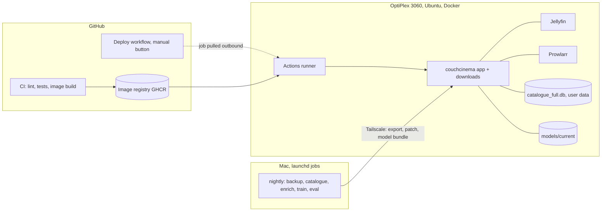

# Deployment plan: Mac trains, OptiPlex serves

Written 2026-10-09. Status: **plan only, nothing built yet.** Build one task at a time, only when Labiba says go.

This plan is written to be executed by Sonnet and Haiku. You don't run the tasks one by one: one Sonnet session builds a whole milestone, hands the small tasks to Haiku helpers, and opens one PR per phase. See **How to run this plan** below.

---

## 1. The shape in one picture



- **Server (`mars`: Dell OptiPlex 3060, i5-9500T, 16GB, x86_64, Ubuntu 24.04):** runs only what the two of you use: the web app (which also does the torrent downloads), Jellyfin and Prowlarr, each in its own Docker container, always restarting. No torch, no training.
- **Mac:** does the heavy and occasional work as scheduled jobs: backup pull, catalogue refresh, enrichment, training, evaluation, publishing models.
- **GitHub:** checks every change. Deploys happen only when Labiba presses "Run workflow" on the Deploy workflow, and only for a commit whose checks passed.
- **Network:** everything between Mac and server goes over Tailscale. The server needs no open ports and no Tailscale rule changes, because the Actions runner connects *out* to GitHub.

## 2. Decisions already made (don't reopen)

| Topic | Decision |
|---|---|
| Server hardware | Dell OptiPlex 3060 `mars`: i5-9500T (6 cores), 16GB RAM, one 238GB SSD (~166GB free), Intel UHD 630. Images are `linux/amd64`. Jellyfin uses Quick Sync via `/dev/dri/renderD128`. |
| Server OS | Already installed: Ubuntu 24.04.4 LTS, Docker 29 + Compose v2, Tailscale (`mars.tailc3278f.ts.net`), unattended-upgrades. |
| Shared machine | `mars` also runs Home Assistant, Matter bridges, cloudflared and a tplink proxy in Docker. Our stack must never touch them (see section 4a). |
| Isolation | Docker Compose, one container per service, `restart: unless-stopped`. |
| Media storage | Internal SSD now (`/srv/media`, ~166GB free), external HDD later (`/mnt/media`). Only the `MEDIA_ROOT` value changes. |
| User data | Lives on the server, on the internal drive, always. Never on the external drive. |
| Backups | User data only (the SQLite DB). Never media. |
| Downloads | Run on the server, files land on the server. |
| Training | On the Mac only. |
| Deploy access | Self-hosted GitHub Actions runner on the server (outbound only). No Tailscale ACL changes for CI. |
| Deploy trigger | Manual (`workflow_dispatch`), only for a commit with green CI. Automatic rollback if the health check fails. |
| Code host | GitHub (already there; least friction). |

## 3. The one hard problem: ids

Read this before touching any data task. It is the reason the data flow looks the way it does.

- `catalogue_full.db` holds **both** the catalogue (`media_items`, `vibe_clusters`, …) **and** the user data (`watch_history`, `rating_details`, `watch_later`, `profiles`, …) in one file.
- User tables point at `media_items.id`, an autoincrement integer.
- The model files point at the same ids: `models/tiger/semantic_ids.json`, `item_map.json` and `models/vibe/item_ids.json` are keyed by `media_items.id`.
- The app adds catalogue rows on its own too (Rate search imports from TMDB via `tmdb_import`).

So:

1. **The server is the only place ids are assigned.** After cutover the Mac never ships a whole database to the server.
2. **The server never deletes or renumbers `media_items`.** "Garbage" titles are simply never added, or are hidden with a flag, so old model files never point at a missing id.
3. **Everything the Mac sends that changes the database is a patch keyed by `(media_type, tmdb_id)`**, never by `id`. The server maps it to its own ids when applying.
4. **The Mac always trains on a fresh copy of the server database**, pulled after its catalogue patch was applied, so the ids in the model match the server's ids.

## 4. Layout on the server

```
/srv/couchcinema/
  compose.yaml          # copied from the repo by each deploy
  .env                  # secrets, written once by hand (TMDB, Jellyfin, Prowlarr, ADMIN_TOKEN, NTFY_TOPIC)
  config.server.yaml    # server version of config.yaml (paths under /media)
  data/catalogue_full.db
  models/releases/<bundle_id>/   # last 3 model bundles
  models/current -> releases/<bundle_id>
  backups/pre-deploy/   # DB snapshot before each deploy, keep 7
  deployed_tag          # image tag currently running
  jellyfin/config, jellyfin/cache, prowlarr/config
/srv/media/Movies, /srv/media/Shows, /srv/media/downloads   # MEDIA_ROOT, moves to /mnt/media later
```

**Path rule:** every container mounts `MEDIA_ROOT` at the same path, `/media`. The app tells Jellyfin about files by path, so the path must be identical inside both containers.

---

## 4a. What's already on `mars` (surveyed 2026-10-09, read-only)

- **Other services we must not disturb:** containers `homeassistant`, `matter-server`, `matterbridge`, `cloudflared`, `tplink-proxy`; Ollama installed on the host. Ports in use: 22, 8123, 8088, 5580, 5540, 8283, 21064-21066, 18555, 20241.
- **Ports we need are free:** 8000, 8096, 9696, 6881-6891.
- **No existing media stack:** no Jellyfin, Plex, qBittorrent or *arr anywhere. `/srv`, `/mnt`, `/media` are empty.
- **Storage is the limit:** one 238GB SSD with ~166GB free, shared with the OS and Home Assistant. Media starts on it, capped at 100GB (Labiba's call, 2026-10-09); the external drive comes later.
- **GPU:** `/dev/dri/renderD128` exists. Give the Jellyfin container access with `devices` + `group_add` of the host's `render` group id; no host user changes needed.

Rules that follow from this:
1. Our stack is its own compose project (`name: couchcinema`) on its own Docker network. Deploy scripts only ever address that project (`docker compose -p couchcinema ...`); never `docker system prune`, never stop or restart containers outside it.
2. Set memory limits so a busy download or transcode can't starve Home Assistant: app 2GB, Jellyfin 4GB, Prowlarr 512MB.
3. Media is capped at **100GB** for now (setting `torrent.max_media_gb: 100`). The app refuses to start a download when the media folder plus that download's size would go over the cap, or when free disk would drop below 20GB, and shows why. Raising the cap is a one-line config change.
4. Don't expose anything through the existing cloudflared tunnel. Access is over Tailscale only.

## How to run this plan

Four milestones. Each one is a single instruction to a single Sonnet session, which plans the work, gives the tasks marked (Haiku) to Haiku helpers, runs the checks, and opens **one PR per phase**. You review and merge PRs at the end of each milestone; you don't supervise individual tasks.

| Milestone | Phases | Needs you for | Result |
|---|---|---|---|
| M1 Package | 1, 2, 3 | Merging 3 PRs, protecting `main` (P3.3) | App runs in Docker, CI checks every PR |
| M2 Go live | 4, 5, 8 | Running one setup command over SSH | App on the OptiPlex, one-click deploys, alerts |
| M3 Learning loop | 6, 7 | Merging 2 PRs, running one install command on the Mac | Nightly training publishes models to the server |
| M4 Polish | 9, 10 | Plugging in the drive and running one command | External drive, README story |

Labiba's step-by-step, with the exact prompt for each milestone, is `docs/BUILD_GUIDE.md`. Every milestone ends with a "Your turn" checklist. The general shape of the prompt:

> Build milestone M1 from docs/DEPLOYMENT_PLAN.md. Read PROJECT_HANDOVER.md and the plan first, not the whole repo. Follow "Rules for whoever builds this". Use Haiku subagents for tasks marked (Haiku). One branch and one PR per phase, each PR passing `make check`. Tick the task checkboxes and update the handover in each PR. Stop and ask me only if a decision changes what we agreed in section 2.

Before starting M1, run the two quick checks in **Phase 0** below. They test the riskiest assumptions in under an hour, so a surprise doesn't land halfway through.

## Phase 0: Prove the risky bits first (Sonnet, part of M1)

- **libtorrent in Docker:** build a throwaway `python:3.12-slim` image for `linux/amd64` that installs the pinned `libtorrent` and imports it. If no wheel exists, pick the version that has one and note it.
- **ids survive a round trip:** copy `catalogue_full.db`, add one item through `tmdb_import` on the copy, and confirm the existing `models/tiger/semantic_ids.json` ids still all exist in `media_items`. This confirms section 3's rule before code depends on it.
- Report both results in the M1 PR description. No code from this phase is kept.

## 5. Rules for whoever builds this

1. Read `PROJECT_HANDOVER.md` and this file first. Don't read the whole repo.
2. One phase = one branch from `main` = one PR. Name branches `deploy/phase-<n>`, e.g. `deploy/phase-1`. Inside the PR, one commit per task.
3. Run `uv run pytest -q` before every push. Never skip or delete a test to get green.
4. Push after each finished task, then update `PROJECT_HANDOVER.md` (branch list and section 13) in the same PR.
5. Tick the task's checkbox in this file in the same PR.
6. Never put secrets in the repo. Secrets go in the server's `.env` or the Mac's `~/.couchcinema/env`.
7. Don't change recommender behaviour in these tasks. This is plumbing.
8. Keep Labiba's manual work to the minimum: anything that can be a script is a script. Steps marked **[Labiba]** are the few that need her hands (installing an OS, approving a device, pasting a token); write those as short numbered steps in `deploy/RUNBOOK.md`.
9. Haiku tasks are small and mechanical. If a Haiku task turns out to need a design choice, stop and hand it to Sonnet.

---

## Phase 1: Make the app portable (no behaviour change)

### [ ] P1.1 Dev tooling (Haiku)
- Add a `dev` dependency group in `pyproject.toml` with `pytest` and `ruff`; refresh `uv.lock`.
- Add `[tool.ruff]` with a deliberately small rule set so nothing gets reformatted: `select = ["E9", "F63", "F7", "F82"]` (syntax errors and undefined names only).
- Add a `Makefile` with `check: ruff check . && pytest -q`.
- **Done when:** `uv sync --group dev && make check` passes locally.

### [ ] P1.2 Config and paths from environment (Sonnet)
- `server.py` has `CONFIG_PATH = "config.yaml"`. Read `os.getenv("CONFIG_PATH", "config.yaml")` instead.
- Add `MODELS_DIR` (default `models`) and use it everywhere `models/` is hard-coded: `services/recommender_service.py`, `services/generative_retriever.py` (respect existing `TIGER_MODEL_DIR` if set), `services/vibe_index.py`, `server.py`.
- Add `deploy/config.server.yaml`: a copy of `config.yaml` with `media_folders: [/media/Movies, /media/Shows]`, `jellyfin_library.movie_dir: /media/Movies`, `tv_dir: /media/Shows`, `torrent.download_dir: /media/downloads`, `database_path: /data/catalogue_full.db`, and `enable_upnp: false`, `enable_natpmp: false`.
- **Done when:** tests pass, and `CONFIG_PATH=deploy/config.server.yaml MODELS_DIR=/tmp/x uv run python -c "import server"` starts without touching `/Users/...` paths.

### [ ] P1.3 Health and version endpoint (Haiku)
- Add `GET /healthz` returning `{"ok": true, "git_sha": $GIT_SHA, "model_bundle": <id from models/current/manifest.json or null>, "db_schema": <schema version>}`. It must also run `SELECT 1` on the DB and return 503 if that fails.
- Add a test in `tests/test_healthz.py` using FastAPI's `TestClient`.
- **Done when:** the test passes.

### [ ] P1.4 Split serve and train dependencies (Haiku)
- Confirm nothing in `server.py`, `services/`, `database.py`, `scanner.py`, `enricher.py` imports torch, sentence-transformers or anthropic at module level. Training already uses `uv run --with torch`; keep it that way.
- Move `anthropic` usage behind the existing `llm` extra (already done; just verify).
- **Done when:** `uv sync --no-dev` (no extras) is enough to import `server`.

## Phase 2: Containers

### [ ] P2.1 Dockerfile (Sonnet)
- `Dockerfile` at repo root: `python:3.12-slim`, install uv, `uv sync --frozen --no-dev`, copy app code (not `training/`, `sample_library/`, `*.db`, `models/`), run as a non-root user, `EXPOSE 8000`, `HEALTHCHECK` hitting `/healthz`, `CMD ["uv","run","--no-sync","python","server.py"]`.
- Bake `ARG GIT_SHA` into `ENV GIT_SHA`.
- `.dockerignore` mirroring the above plus `.git`, `.venv`, `downloads`, `backups`, `reports`.
- Check that `libtorrent` installs from wheels on `linux/amd64` for the pinned version. If not, pin to the newest version that has a wheel and say so in the PR.
- **Done when:** `docker build --platform linux/amd64 .` succeeds and the image is under 600MB.

### [ ] P2.2 Compose file (Sonnet)
- `deploy/compose.yaml` with three services, all `restart: unless-stopped`, all on one network:
  - `app`: image `ghcr.io/rupaai/smart-recommender-player:${IMAGE_TAG}`, env from `.env` plus `CONFIG_PATH=/config/config.server.yaml`, `MODELS_DIR=/models/current`, `DATABASE_PATH=/data/catalogue_full.db`, `JELLYFIN_URL=http://jellyfin:8096`, `PROWLARR_URL=http://prowlarr:9696`. Mounts `./data:/data`, `./models:/models`, `./config.server.yaml:/config/config.server.yaml:ro`, `${MEDIA_ROOT}:/media`. Ports `8000:8000` and `6881-6891:6881-6891` (tcp+udp).
  - `jellyfin`: `jellyfin/jellyfin:<pinned version>`, mounts `./jellyfin/config`, `./jellyfin/cache`, `${MEDIA_ROOT}:/media`, `devices: [/dev/dri:/dev/dri]`, port `8096:8096`.
  - `prowlarr`: `lscr.io/linuxserver/prowlarr:<pinned version>`, mounts `./prowlarr/config`, port `9696:9696`.
- On startup the app creates `/media/Movies`, `/media/Shows` and `/media/downloads` if they don't exist and leaves them alone if they do (`os.makedirs(..., exist_ok=True)`). Same for `/data` and `/models/releases`.
- Follow section 4a: top-level `name: couchcinema`, its own network, memory limits (app 2GB, Jellyfin 4GB, Prowlarr 512MB), Jellyfin `group_add: ["${RENDER_GID}"]`.
- Disk guard in the app: refuse to start a download when the size of `/media` plus the download would exceed `torrent.max_media_gb` (default 100) or free space would fall below `torrent.min_free_gb` (default 20), with a clear message in the Download tab. Count in-progress downloads at their full size.
- Pin every third-party image to an exact version (no `latest`).
- `deploy/.env.example` listing every variable with a comment and no values: `IMAGE_TAG`, `MEDIA_ROOT`, `TMDB_API_KEY`, `JELLYFIN_API_KEY`, `JELLYFIN_USER_ID`, `PROWLARR_API_KEY`, `ADMIN_TOKEN`, `NTFY_TOPIC`.
- **Done when:** on the Mac, with a local image tag and `MEDIA_ROOT=./sample_library`, `docker compose -f deploy/compose.yaml up` serves the app on :8000 and Jellyfin on :8096, and `/healthz` is ok.

## Phase 3: CI (checks on every change)

### [ ] P3.1 CI workflow (Sonnet)
- `.github/workflows/ci.yml`, on `pull_request` and `push` to `main`:
  - job `check` (`ubuntu-latest`): checkout, `astral-sh/setup-uv`, `uv sync --frozen --group dev`, `make check`.
  - job `image` (needs `check`): `docker/setup-buildx-action`, `docker/build-push-action` for `linux/amd64` with `GIT_SHA` build arg and GHA layer cache. On PRs build only; on `main` push to `ghcr.io/rupaai/smart-recommender-player:sha-<full sha>` and `:main`, using `GITHUB_TOKEN` with `packages: write`.
- **Done when:** a PR shows both jobs green, and after merge the image appears under the repo's Packages.

### [ ] P3.2 Dependency updates (Haiku)
- `.github/dependabot.yml` for `pip`/uv (`/`), `docker` (`/` and `/deploy`), and `github-actions`, weekly, grouped into one PR per ecosystem.
- **Done when:** the file validates (Dependabot shows it under Insights → Dependency graph).

### [ ] P3.3 Branch protection [Labiba]
- On GitHub: Settings → Branches → protect `main`, require the `check` and `image` jobs to pass before merging.

## Phase 4: Set up the server once

`mars` already has Ubuntu, Docker, Tailscale and automatic security updates, so there's nothing to install by hand. What's left is one script run over SSH from your Mac (`ssh gabstevens@mars`, which already works with your key).

### [ ] P4.1 One-command setup script (Sonnet)
`deploy/bootstrap.sh`, safe to run again (skips anything already done; checks rather than installs Docker/Tailscale/unattended-upgrades and stops with a clear message if one is missing):
1. Creates a `deploy` system user in the `docker` group only (no sudo). The runner and deploys run as this user, not as `gabstevens`, so CI never has his sudo rights.
2. Creates `/srv/couchcinema/{data,models/releases,backups/pre-deploy,jellyfin/config,jellyfin/cache,prowlarr/config}` and `$MEDIA_ROOT/{Movies,Shows,downloads}` if missing, owned by `deploy`.
3. Copies `config.server.yaml` and `compose.yaml` into place and writes the host's `render` group id into `.env` for Jellyfin.
4. Asks for each secret once (TMDB key etc.), generates `ADMIN_TOKEN`, writes `.env` (mode 600), and prints the token to copy to the Mac. The Jellyfin API key and user id can't exist until Jellyfin's first-run wizard is done, so they're optional here; `bootstrap.sh --set KEY=value` adds one later and restarts only our app container.
5. Installs the GitHub Actions runner as a service under `deploy` with label `mars`, using a registration token you paste in.
6. Installs the healthcheck and disk-check cron entries (P8.1).
7. Runs `docker compose -p couchcinema up -d` and waits for `/healthz`.
- **Done when:** on a fresh Ubuntu 24.04 VM with Docker and a dummy container running, it reaches a healthy app, leaves the dummy container untouched, and a second run changes nothing.

### [ ] P4.2 Your part [Labiba]
1. Check with your boyfriend that it's fine to add a `deploy` user and the media stack next to Home Assistant.
2. From your Mac: `ssh gabstevens@mars`, then `git clone https://github.com/rupaai/smart-recommender-player && sudo ./smart-recommender-player/deploy/bootstrap.sh`. Git asks for your GitHub username and a token because the repo is private; the runbook says where to make the token. Paste the secrets and the runner token when asked.
3. Copy your data across once: stop the app on the Mac, then `scp catalogue_full.db gabstevens@mars:/tmp/` and let the runbook's one-line command move it into `/srv/couchcinema/data/`. Copy existing films into `/srv/media` the same way. From now on you both rate and watch through the server; the Mac's copy is only for development.
4. Open Jellyfin at `http://mars:8096`, finish its first-run wizard (libraries are `/media/Movies` and `/media/Shows`) and turn on Intel Quick Sync under Playback.

Security notes: keep the repo **private** (a self-hosted runner on a public repo can run code from forks). Only the deploy workflow uses the `mars` label.

## Phase 5: Deploy with one button

### [ ] P5.1 Deploy script (Sonnet)
- `deploy/deploy.sh <image_tag>`, run on the server by the runner from a checkout of the deployed commit:
  1. Copy `deploy/compose.yaml` to `/srv/couchcinema/`.
  2. Snapshot the DB with `sqlite3 data/catalogue_full.db ".backup backups/pre-deploy/<timestamp>.db"`; keep the newest 7.
  3. Remember the old tag from `deployed_tag`.
  4. `IMAGE_TAG=<new> docker compose -p couchcinema pull app && docker compose -p couchcinema up -d`.
  5. Poll `http://localhost:8000/healthz` for up to 90s and check its `git_sha` matches.
  6. On success write the new tag to `deployed_tag`. On failure bring the old tag back up, print the app's last 100 log lines, and exit non-zero.
- The schema migration runs when the app starts (`DatabaseManager`), so the pre-deploy snapshot is the way back if a migration goes wrong. The script does **not** restore it automatically; restoring is a runbook step.
- **Done when:** `shellcheck` passes and a dry run with a deliberately broken tag rolls back.

### [ ] P5.2 Deploy workflow (Sonnet)
- `.github/workflows/deploy.yml`, `on: workflow_dispatch` with input `ref` (default `main`).
  - job `verify` (`ubuntu-latest`): resolve `ref` to a SHA; fail unless the CI workflow run for that SHA concluded `success` and image `sha-<sha>` exists.
  - job `deploy` (needs `verify`, `runs-on: [self-hosted, mars]`, `environment: production`, `concurrency: deploy`): checkout that SHA, run `deploy/deploy.sh sha-<sha>`, send an ntfy message with the result.
- **Done when:** pressing Run workflow on `main` deploys and the app's `/healthz` shows the new SHA; running it on a commit with red CI stops at `verify`.

### [ ] P5.3 Runbook additions (Haiku)
- In `deploy/RUNBOOK.md`: how to roll back (re-run Deploy on the older commit), how to restore a pre-deploy DB snapshot, how to read logs (`docker compose logs app`).

## Phase 6: Mac ↔ server data flow

### [ ] P6.1 Admin API (Sonnet)
All under `/admin`, require header `Authorization: Bearer $ADMIN_TOKEN`, return 404 when `ADMIN_TOKEN` is unset.
- `GET /admin/export`: streams a consistent copy of the DB made with SQLite's online backup API (`sqlite3.Connection.backup`) into a temp file. Include `X-Media-Items-Max-Id`.
- `POST /admin/catalogue-patch`: body is JSONL, one row per item `{media_type, tmdb_id, fields:{...}}` plus optional `{table:"vibe_clusters", rows:[...]}` replace blocks. Inserts unknown `(media_type, tmdb_id)` rows (the server assigns ids), updates listed columns on known ones, never deletes. Runs in one transaction. Returns counts.
- Allow-list the columns a patch may set (catalogue and enrichment columns of `media_items` only). Reject anything touching user tables.
- Tests: patch inserts, updates, rejects user-table columns, and is idempotent when applied twice.
- **Done when:** tests pass.

### [ ] P6.2 Model bundles (Sonnet)
- A bundle is `bundle-<UTC timestamp>.tar.gz` containing `tiger/…`, `vibe/…`, an optional `db_patch.jsonl` (columns training writes, e.g. `facets`, `vibe_cluster_id`, plus `vibe_clusters`), and `manifest.json`: `{bundle_id, created_at, git_sha, source_db_max_id, files:{path: sha256}, metrics:{...}, gate:"passed"}`.
- `POST /admin/model-bundle` (multipart upload):
  1. Verify every sha256 and that `gate == "passed"`.
  2. Check every item id in `semantic_ids.json` and `vibe/item_ids.json` exists in `media_items`.
  3. Unpack to `models/releases/<bundle_id>/`, load it in a throwaway retriever and run one recommendation as a smoke test.
  4. Apply `db_patch.jsonl` (same code as P6.1) and atomically repoint `models/current` (write a temp symlink, then `os.replace`).
  5. Reload models in-process under a lock (re-create the generative retriever and vibe index). If the reload fails, point `current` back and reload again.
  6. Keep the newest 3 releases.
- `POST /admin/model-rollback`: repoint to the previous release and reload.
- **Done when:** tests cover a good bundle, a bad checksum, a missing id, and rollback.

### [ ] P6.3 Mac client (Sonnet)
- `ops/mac/cc.py` with subcommands that talk to `http://mars:8000` (the Tailscale name, `mars.tailc3278f.ts.net`; traffic is encrypted by Tailscale) (from `~/.couchcinema/env`): `export <out.db>`, `diff-catalogue <before.db> <after.db> <out.jsonl>` (rows keyed by `(media_type, tmdb_id)`, only allow-listed columns), `push-patch <file>`, `build-bundle <out.tar.gz>`, `push-bundle <file>`.
- **Done when:** a round trip against a local `docker compose` server works: export, run a catalogue script on the copy, diff, push, and the new rows appear on the server.

## Phase 7: Mac scheduled jobs

### [ ] P7.1 Nightly pipeline script (Sonnet)
`ops/mac/nightly.sh`, one lock file so runs never overlap, logs to `~/Library/Logs/CouchCinema/<date>.log`, each step can be skipped by flag:

1. **Backup:** `cc.py export` to `~/CouchCinemaBackups/<date>.db`, check `PRAGMA integrity_check`, keep 30 days. This is the user-data backup.
2. **Catalogue refresh (weekly, Sundays):** copy the backup to a work file, run `utils/build_full_catalogue.py` and the backfills on it with a quality floor so garbage stays out (start with `vote_count >= 200 and rating >= 6.0`, as settings in `config.yaml`), then enrichment (`utils/mood_tag.py`, `utils/backfill_tmdb_vibe.py`). `cc.py diff-catalogue` and `push-patch`.
3. **Fresh snapshot:** `cc.py export` again so training sees the server's ids.
4. **Train:** `training/retrain_tiger.sh` and `training/build_vibe_index.py` against the snapshot (`DATABASE_PATH` pointing at it). Stop the script from copying into the local `models/`; it writes to a staging folder instead.
5. **Evaluate:** run the existing gates (`export_tiger_onnx.py` deployment gates, `utils/eval_taste_model.py`) and compare with the metrics in the server's current manifest. Set `gate:"passed"` only if no metric drops by more than 1% (setting in `config.yaml`).
6. **Publish:** `cc.py build-bundle` and `push-bundle` if the gate passed; otherwise keep the bundle locally and say why in the log.
7. **Report:** ping healthchecks.io on success, send an ntfy message on any failure.

**Done when:** a full run against the real server either publishes a bundle or explains in the log why it didn't.

### [ ] P7.2 launchd job (Haiku)
- `ops/mac/com.couchcinema.nightly.plist` with `StartCalendarInterval` at 03:30. launchd runs a missed job when the Mac wakes. Install instructions in `ops/mac/README.md` (`launchctl bootstrap gui/$(id -u) …`).
- **Done when:** `launchctl print` shows the job and a manual `launchctl kickstart` runs it.

## Phase 8: Know when something breaks

### [ ] P8.1 Alerts (Haiku)
- Server cron, installed by `bootstrap.sh` (add it to P4.1 if Phase 8 lands later): every 5 minutes, `curl -fsS localhost:8000/healthz && curl -fsS <healthchecks.io ping url>`. If the pings stop, healthchecks.io emails/pushes you, even when the whole box is down.
- Daily disk check: send an ntfy message if media is above 85GB of its 100GB cap, or `/` is above 85% full.
- Install the ntfy app on both phones and subscribe to the private topic name from `.env`.
- **Done when:** stopping the app container triggers an alert within 15 minutes.

### [ ] P8.2 Disk housekeeping (Sonnet, optional)
- Setting `cleanup.delete_watched_after_days` (default off). A daily server job lists downloads both of you have marked watched more than N days ago and deletes them, logging what it removed. Ships off; Labiba turns it on.

## Phase 9: Moving to the external drive

### [ ] P9.1 Move-media script (Sonnet)
`deploy/move-media.sh`:
1. Lists attached drives and asks which one. If it isn't already ext4 labelled `media`, it shows the drive's size and name and asks you to type `FORMAT` before erasing it (this is the one step that can't be undone).
2. Adds `LABEL=media /mnt/media ext4 defaults,nofail,x-systemd.device-timeout=10s 0 2` to `/etc/fstab` if missing (`nofail`: a missing drive never blocks boot) and mounts it.
3. Creates `Movies`, `Shows`, `downloads` on it if missing, then `rsync`s everything from the old `MEDIA_ROOT`.
4. Sets `MEDIA_ROOT=/mnt/media` in `.env`, restarts the stack, waits for `/healthz`, and triggers a Jellyfin library scan through its API.
5. Leaves the old folder in place and prints the command to delete it once you've checked things play.
- **Done when:** it works on a VM with a spare virtual disk, and re-running it is harmless.

### [ ] P9.2 Your part [Labiba]
Plug in the drive and run `sudo ~/smart-recommender-player/deploy/move-media.sh` over SSH. Answer its questions.

## Phase 10: Make it presentable (Haiku)

- README section "Architecture & operations" with the diagram from section 1, the CI/CD flow, and the model release flow (models ship separately from code and only when they beat the current one).
- A short ADR folder `docs/adr/`: 001 single server owns ids, 002 outbound runner instead of Tailscale ACLs, 003 model bundles with eval gate.

---

## Later (not in this plan)

- Weekday download scheduling ("download by day of the week"). It belongs on the server inside the app, using the current model's recommendations. Plan it separately once Phase 6 works.
- Subtitle-based enrichment on the Mac. It slots into P7.1 step 2 as one more script writing allow-listed columns.
- A staging copy of the stack on the Mac for trying a release before deploying.

## Suggested order

M1 (Phase 0, 1, 2, 3) → M2 (Phase 4, 5, 8) → M3 (Phase 6, 7) → M4 (Phase 9 when the drive arrives, Phase 10).

The app is usable on the server at the end of M2. M3 brings learning back; until then, models can be copied to `/srv/couchcinema/models/releases/` by hand once.
