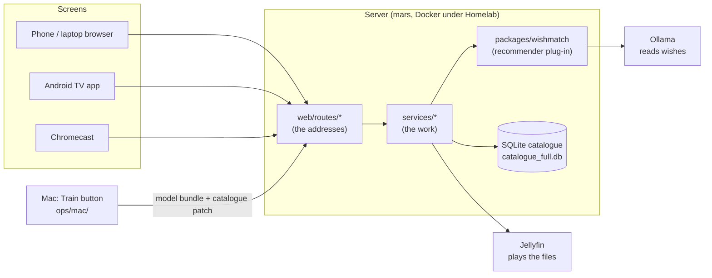

# Knowledge map

Use this page to find where a feature lives and what to edit to change it. Each section
says what the feature does, which files hold it, which settings tune it, and which tests
check it. For how things work in plain words, see the guides in [docs/guides/](guides/).

**Kept current:** every change to the code updates this page in the same PR (rule in
`AGENTS.md`). If something here is wrong, fix it here.

Quick words used below:
- **route**: a web address the server answers, like `/api/nl/play/12`. Routes live in `web/routes/`.
- **service**: the code that does the work behind a route. Services live in `services/`.
- **setting**: a value in a YAML file you can change without touching code.
- **test**: a script in `tests/` that checks a behaviour. `make check` runs them all.

## The big picture

## Folders at a glance

| Folder or file | What is in it |
|---|---|
| `server.py` | Builds the app from the route files and starts it. Start-up jobs (resume downloads, Wishmatch model, watched cleanup, Jellyfin libraries). |
| `web/` | The HTTP layer. `state.py` = the shared objects (database, Jellyfin, recommenders...). `routes/` = one file per area. See `web/README.md`. |
| `services/` | The logic: recommenders, playback, downloads, people, casting... One file per job. |
| `packages/wishmatch/` | The Wishmatch recommender core. Knows nothing about films; removable and reusable. |
| `database.py` | Every table and every database query. Migrations at the top (`_migrate_vN_*`). |
| `templates/`, `static/` | Web pages. `index.html` + `app.js` = the original app. `nl/` = Northern Lights phone/laptop pages. `nl/tv/` = TV pages. |
| `tv-app/` | The Android TV app (Kotlin). It shows the server's TV pages and plays video with Media3. |
| `config.yaml` | Shared settings with no personal values. |
| `config.local.yaml` | **Your** settings (people, folders). Git ignores it. Copy `config.local.example.yaml`. |
| `homelab/config.yaml` | The settings the server on mars uses (people, `/media` paths, `engine: wishmatch`). |
| `recommender_rules.yaml` | Every recommender word list and weight, for legacy and Wishmatch. |
| `homelab.yaml` | How Homelab runs the app on mars: image, ports, secrets, Jellyfin/Prowlarr/Ollama services. |
| `Dockerfile` | How the server image is built. |
| `ops/mac/` | The Train button and the Mac's admin client (`cc.py`). |
| `training/` | Model building on the Mac (vibe index, MovieLens crowd). |
| `utils/` | One-off and maintenance scripts (catalogue build, backfills, mood tagging, scanner). |
| `tests/` | One script per area, plus `tests/js/` (browser logic) and `tests/mac/` (Train button). |
| `PROJECT_HANDOVER.md` | State of every feature and what is open. Written for Claude, useful for you. |
| `handover/notes/` | Notes waiting to be folded into the handover by a bot. |

## Settings and personal setup

- **What:** which people, folders, server and engine the app uses.
- **Files:** `config.yaml` (shared), `config.local.yaml` (yours, laid on top), `homelab/config.yaml` (mars). Loaded by `services/app_config.py` (`load_config()`).
- **Change it:** to add a person, add a line under `northern_lights.people` (id, name, Jellyfin user, profile 1 or 2). On mars, edit `homelab/config.yaml` in the repo; it is baked into the image, so it needs a PR and a deploy.
- **Secrets** (TMDB key, Jellyfin key, admin token) are never in these files: `.env` locally, Homelab secrets on mars.
- **Tests:** `tests/test_app_config.py`.

## Who's watching (people)

- **What:** the "who's watching?" screen, a cookie per screen, each person's own Jellyfin user and ratings profile, "Both of us".
- **Files:** `services/nl_people.py`; routes `web/routes/nl_viewer.py`; helper `_nl_viewer` in `web/helpers.py`; pages `templates/nl/who.html`, `templates/nl/tv/who.html`.
- **Per-person settings** (languages, subtitle look, skip length, autoplay, quality cap): `services/nl_settings.py`, `static/nl/prefs.js`, `static/nl/me.js`.
- **Tests:** `tests/test_nl_people.py`, `tests/test_nl_settings.py`.

## Recommendations

### The engine switch
- **What:** picks who answers every recommendation: `wishmatch` or `legacy`.
- **Setting:** `recommender.engine` in `homelab/config.yaml` (mars) or `config.yaml`.
- **Files:** `services/wishmatch_movies/router.py` (`EngineSwitch`). If Wishmatch fails, legacy answers and the log says why.
- **Routes:** `/api/recommend`, `/api/discover/*` (questions), `/api/rec/*` (Wishmatch only), in `web/routes/discover.py`.

### Wishmatch (the main recommender)
- **What:** reads what you typed (the "wish"), picks well-known candidates, asks at most two questions, scores by mood match + both tastes + quality, and says why. Guide: [guides/wishmatch.md](guides/wishmatch.md).
- **Core plug-in** (`packages/wishmatch/wishmatch/`): `wish.py` word lookup, `llm.py` the model's reading and question wording, `candidates.py` the shortlist, `engine.py` scoring and mixing films/shows, `matcher.py` mood match, `profiles.py` taste, `crowd.py` MovieLens fans, `questions.py`, `explain.py` the reasons, `settings.py` defaults, `adapter.py` the contract a project fills in.
- **Film/TV part** (`services/wishmatch_movies/`): `adapter.py` turns catalogue rows into items, `service.py` (`WishmatchMovies`), `session.py` the questions pop-up.
- **Settings:** `wishmatch:` in `recommender_rules.yaml` (weights, candidate counts, film/show mix, the wish-reader model and its wait time, questions).
- **Word list:** `services/vibe_vocab.py` (mood dials and feeling words) plus `wishmatch.lexicon` and `wishmatch.genre_hints` in `recommender_rules.yaml`. A word that does nothing goes there.
- **Taste profiles:** `utils/wishmatch_profiles.py` (made at Train time); read or edit them at `GET/PUT /api/rec/movies/profile/{person}`.
- **Tests:** `packages/wishmatch/tests/` (run by `tests/test_wishmatch_core.py`), `tests/test_wishmatch_movies.py`, `tests/test_wishmatch_crowd.py`, `tests/test_wishmatch_profiles.py`, `tests/test_compare_engines.py`.
- **Remove it:** delete `packages/wishmatch/`, `services/wishmatch_movies/`, the `wishmatch:` section, and set `engine: legacy`.

### Legacy recommender (the fallback)
- **What:** the older rules engine: SQL filters, a quality cut, taste, genre words, vibe search, variety.
- **Files:** `services/recommender_service.py`; rules `recommender_rules.yaml` (loaded by `services/recommender_rules.py`); design notes `docs/RECOMMENDER_ARCHITECTURE.md`.
- **Settings:** funnel sizes and taste formula under `recommender:` in the config; every word list and weight in `recommender_rules.yaml`.
- **Tests:** `tests/test_ratings.py`, `tests/test_recommender_rules.py`, `tests/test_vibe_index.py`.

### Questions pop-up (legacy) and mood map
- **Files:** `services/mood_popup.py` (`MoodSession`), `services/mood_questions.py`, `services/vibe_moods.py` (30 night moods), `services/vibe_popup.py` (film features, session store).
- **Setting:** `recommender.mood_weight`.
- **Tests:** `tests/test_mood_popup.py`, `tests/test_vibe_moods.py`.

### Taste model, vibe index, verdicts
- **Taste model** (off by default): `services/taste_model.py`, `services/taste_runtime.py`, setting `recommender.taste_model.enabled`. Check with `utils/eval_taste_model.py`.
- **Vibe index** (search by feel): built on the Mac by `training/build_vibe_index.py`, served by `services/vibe_index.py`.
- **Verdicts** (rewatch, loved, liked, meh, not for me): `services/verdicts.py`.

## Rating (the Rate tab)

- **What:** rate titles with verdicts and chips, per-season TV verdicts, "this or that" pairs, "Sort out my 7s", search and TMDB import.
- **Files:** routes `web/routes/ratings.py`; `services/verdicts.py`, `services/pairs.py`, `services/catalogue_search.py`; database methods in `database.py` (`rate_item`, `get_rating_queue`...). Front end: `static/app.js`, `templates/index.html`.
- **Tests:** `tests/test_verdicts.py`, `tests/test_pairs.py`, `tests/test_catalogue_search.py`, `tests/test_ratings.py`.

## Watchlist, picks for two, choosing

- **Watch later / watchlist:** `database.py` (`watch_later`), routes `web/routes/watch.py` (original app) and `web/routes/nl_picks.py` (Northern Lights); `static/nl/watch.js`, `watchlist.js`.
- **"For both of us" row:** `services/nl_picks.py`, `static/nl/picks.js`.
- **Choose for us, vetoes, whose turn:** `services/nl_choose.py`, `static/nl/choose.js`. Weekday and time-of-day defaults are `choose_defaults:` in `recommender_rules.yaml`.
- **Watched together, pacts:** `services/nl_together.py`, `static/nl/couple.js`.
- **"How was it?" and spoiler hiding:** `services/nl_reactions.py`.
- **Tests:** `tests/test_watch_later.py`, `tests/test_nl_picks.py`, `tests/test_nl_choose.py`, `tests/test_nl_together.py`, `tests/test_nl_reactions.py`.

## Finding and downloading

- **What:** search Prowlarr, YTS and Apibay; rank the copies; download; file into Jellyfin's folders.
- **Files:** `services/torrent_service.py` (search, download, filing), `services/torrent_ranking.py` ("Best match"), `services/disk_guard.py` (space limits), `services/nl_downloads.py` (states, Retry, restart). Routes `web/routes/torrents.py`, `web/routes/nl_admin.py`.
- **Settings:** `torrent:` (download folder, `max_media_gb`, `min_free_gb`, ports), `torrent_ranking:` (quality points, size bands). Prowlarr address and key are env/secrets.
- **Pages:** Download tab in `static/app.js`; `static/nl/downloads.js` (phone and TV).
- **Tests:** `tests/test_ranking.py`, `tests/test_disk_guard.py`, `tests/test_download_resume.py`, `tests/test_nl_downloads.py`.

## Library and browsing (Northern Lights)

- **What:** home rows, Movies and Shows, title and show pages, search, next episode, recently added, hide from home, cast and trailer.
- **Files:** `services/nl_browse.py`, `services/nl_polish_b.py`; routes `web/routes/nl_library.py`, pages `web/routes/nl_pages.py`; front end `static/nl/home.js`, `browse.js`, `title.js`, `show.js`, `polish.js`, `nl.js`; templates `templates/nl/`.
- **Tests:** `tests/test_nl_browse.py`, `tests/test_nl_polish_b.py`, `tests/test_nl_next.py`.

## Playback

Guide: [guides/playback.md](guides/playback.md).
- **What:** decide how to play a file on each screen (original file or converted copy), audio and subtitle choice, resume, progress for each viewer.
- **Server files:** `services/jellyfin_playback.py` (asks Jellyfin, `stream_for()`), `services/device_profiles.py` (what each screen can play: browser, laptop, TV, cast), `services/nl_track_memory.py` (remembered audio/subtitles), `services/nl_player_extras.py` (thumbnails, chapters, skip intro), `services/nl_picture.py`. Routes `web/routes/nl_play.py` (also the `/nl/jf/` proxy: a strict allowlist, never widen it without a test).
- **Page files:** `static/nl/player-core.js` (the only file that touches the video element or the TV bridge), `player.js` (controls), `player-extras.js`, `subtitles.js`, `cast.js`; `templates/nl/player.html`.
- **Settings:** per-person quality cap and skip length (me page). Laptop profile bitrate is in `device_profiles.py`.
- **Tests:** `tests/test_nl_playback.py`, `tests/test_nl_player_api.py`, `tests/test_nl_device_profile.py`, `tests/test_nl_laptop*.py`, `tests/test_nl_subtitles.py`, `tests/test_nl_track_memory.py`, `tests/test_nl_player_extras.py`, `tests/js/`.

## TV app

Guide: [guides/tv-app.md](guides/tv-app.md).
- **What:** an Android TV app. It shows the server's TV pages (`/nl/tv/`) in a WebView and plays video in Media3 behind them.
- **Files** (`tv-app/app/src/main/java/app/northernlights/tv/`): `MainActivity.kt` (the WebView), `NativeBridge.kt` (`window.NorthernLightsNative`, the calls the page can make), `PlayerController.kt` (Media3 player), `PlaybackLogic.kt` (buffers, track picking), `NlRenderersFactory.kt` and `AudioDownmix.kt` (sound), `SubtitleLook.kt` (subtitle size/position/delay), `VideoSupport.kt` (Dolby Vision 7), `PlaybackCache.kt`, `ServerConfig.kt` + `SettingsActivity.kt` (server address), `UpdateCheck.kt` + `AppUpdater.kt` (self-update).
- **TV pages:** `templates/nl/tv/`, `static/nl/tv/tv.js`, `focus.js` (remote D-pad focus), `tv.css` (the aurora look).
- **Build:** `.github/workflows/tv-app.yml` builds the APK on every push and publishes `main` builds to the `tv-app` pre-release, which the TV checks for updates. Its address is `BASE` in `UpdateCheck.kt` (change it if you fork the repo).
- **Tests:** `tv-app/app/src/test/` (JUnit, run by CI), `tests/test_nl_tv.py`.

## Laptop player (/player)

- Reuses the TV pages with laptop controls. Pages in `web/routes/nl_pages.py` (`/player/...`); laptop profile in `services/device_profiles.py`. Tests: `tests/test_nl_laptop.py`, `tests/test_nl_laptop_quality.py`.

## Casting and the phone keyboard

- **Chromecast:** `services/nl_cast.py` (signed stream links), `static/nl/cast.js` (sender), `cast-receiver.js` (receiver). Setting `northern_lights.cast_base_url`. Notes: `docs/casting.md`.
- **Type on the phone for TV search:** `services/nl_type.py`, `web/routes/nl_type.py`, `static/nl/type.js`, `static/nl/tv/phone-keyboard.js`, `static/nl/qr.js`.
- **Tests:** `tests/test_nl_cast.py`, `tests/test_nl_type.py`.

## Jellyfin

- **What:** Jellyfin holds the files' playback. The app creates and repairs the Movies and Shows libraries and asks it for streams.
- **Files:** `services/jellyfin_service.py` (libraries), `services/jellyfin_playback.py` (streams, progress). Settings `jellyfin_library:`; address and key from env/secrets.
- **Tests:** `tests/test_nl_playback.py`, `tests/nl_fake.py` (a fake Jellyfin the tests use).

## Watched cleanup

- **What:** once a day, deletes a film or episode everyone watched over N days ago (not favourites). Ships in dry run.
- **Files:** `services/media_cleanup.py`. Setting `media_cleanup:` in `homelab/config.yaml` (`dry_run: false` to really delete).
- **Tests:** `tests/test_media_cleanup.py`.

## Status and admin

- **Header status, admin page:** `services/nl_health.py`, `web/routes/nl_admin.py`, `static/nl/health.js`, `admin.js`. Tool links: `northern_lights.tools`.
- **Admin API for the Mac** (`/admin/*`, needs `ADMIN_TOKEN`): `services/admin_api.py`, `services/model_bundle.py` (install, rollback), `services/catalogue_patch.py`.
- **Version and logs:** `services/app_version.py`; JSON logs from `homelab.logs` in `server.py`.
- **Tests:** `tests/test_nl_health.py`, `tests/test_admin_api.py`, `tests/test_healthz.py`, `tests/test_app_version.py`.

## Deployment (mars)

Guide: [guides/deployment.md](guides/deployment.md).
- **Files:** `homelab.yaml` (how Homelab runs it), `homelab/config.yaml` (its settings), `Dockerfile`, `.github/workflows/ci.yml` (checks, then builds the image on `main`).
- **Flow:** merge to `main` -> CI builds `ghcr.io/rupaai/smart-recommender-player:sha-...` -> Homelab puts it on dev -> you press Promote for prod. Never deploy by hand.
- **Secrets:** set in the Homelab companion; they arrive as files and `services/homelab_secrets.py` reads them.
- **Tests:** `tests/test_layout.py` (the image copies every folder the server needs), `tests/test_homelab_secrets.py`, `tests/test_homelab_logs.py`.

## Training and tagging (Mac)

Guide: [guides/training.md](guides/training.md).
- **Train button:** `ops/mac/install.sh` adds it; `ops/mac/train-now.sh` -> `ops/mac/nightly.sh`: backup, weekly catalogue refresh, snapshot, vibe index, MovieLens crowd, mood tags for new titles, taste profiles, check, publish.
- **Files:** `ops/mac/cc.py` (talks to `/admin`), `ops/mac/pipeline.py` (settings, check), `training/`, `utils/build_full_catalogue.py`, `utils/backfill_*.py`, `utils/mood_tag_ollama.py` (free tags with Gemma), `utils/mood_tag.py` (paid Haiku tags; ask first), `utils/wishmatch_profiles.py`.
- **Settings:** `nightly:` in `config.yaml`; `wishmatch.tagging_model`; `~/.couchcinema/env` on the Mac (server address and admin token).
- **Tests:** `tests/mac/test_nightly.sh`, `tests/test_pipeline.py`, `tests/test_mac_client.py`, `tests/test_mood_tag_ollama.py`.

## Database

- **File:** `database.py` (`DatabaseManager`). One SQLite file, `catalogue_full.db` (`DATABASE_PATH` overrides). `catalogue.db` is a small test copy.
- **Add a column or table:** add a new `_migrate_vNN_*` method (additive, safe to run twice) and call it in order at the top; bump `PRAGMA user_version`.
- **Try changes on a copy:** `DATABASE_PATH=/tmp/copy.db uv run python server.py`.

## Looks

- Original app: `static/styles.css` (the light "ticket" look). Phone pages: `static/nl/nl.css`. TV, laptop and player: `static/nl/tv/tv.css`, `static/nl/player.css` (the soft aurora look). Fonts in `static/fonts/`.

## "I want to..." quick list

| I want to... | Edit |
|---|---|
| add or rename a person | `northern_lights.people` in `config.local.yaml` / `homelab/config.yaml` |
| switch recommender | `recommender.engine` (`wishmatch` or `legacy`) |
| make a typed word work in Wishmatch | `wishmatch.lexicon` or `wishmatch.genre_hints` in `recommender_rules.yaml` |
| change films vs shows share | `wishmatch.mix` in `recommender_rules.yaml` |
| make picks better known / more obscure | `wishmatch.candidates.known` and `min_popularity` |
| wait less for the wish reader | `wishmatch.wish_reader.wait_seconds` |
| change the disk cap | `torrent.max_media_gb` in `homelab/config.yaml` |
| turn on real watched cleanup | `media_cleanup.dry_run: false` in `homelab/config.yaml` |
| change "Best match" download ranking | `torrent_ranking:` in the config |
| change the TV look | `static/nl/tv/tv.css` |
| change the player controls | `static/nl/player.js` (logic in `player-extras.js`) |
| change which files play untouched on the TV | `TV_PROFILE` in `services/device_profiles.py` |
| add a page or address | a route in the right `web/routes/*.py` file (see `web/README.md`) |
| add a database column | a new `_migrate_vNN_*` in `database.py` |
