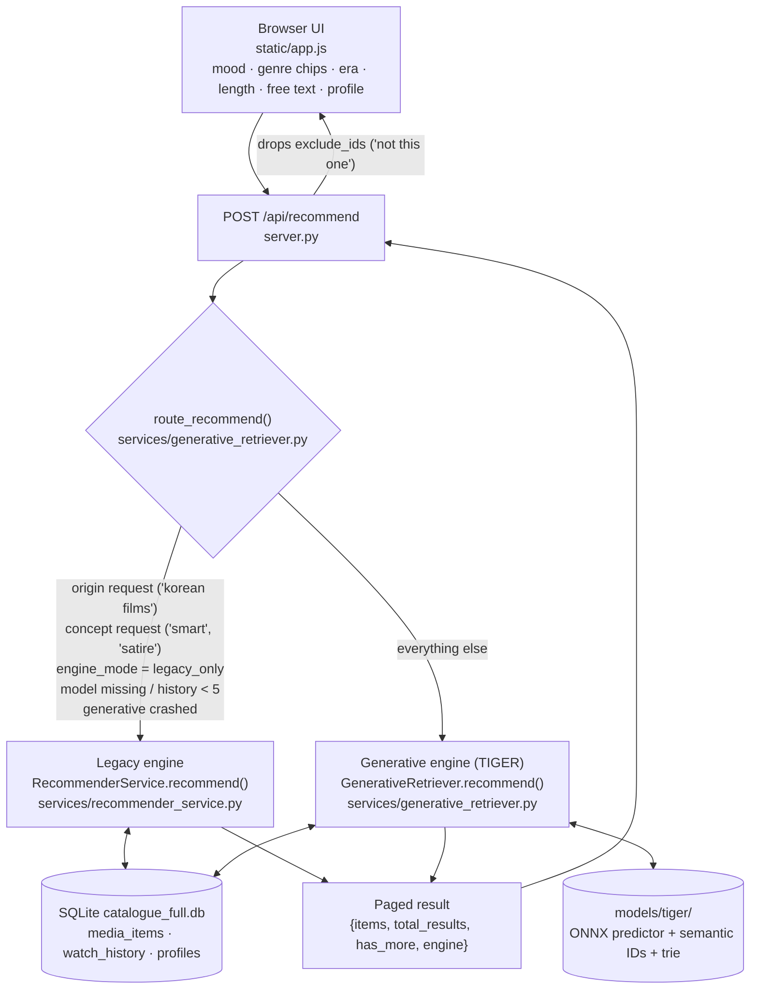
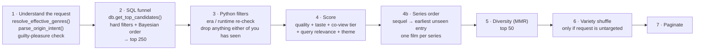

# Recommender Architecture

How a "what should we watch?" request turns into a list of films, as the code behaves on 2026-10-08 (after the series-order and history fixes).

> **One-line summary:** there are two engines. A rules-and-scores engine ("legacy") and a small sequence model ("generative" / TIGER). A router chooses one per request. Right now the generative engine answers almost every request. It has been running on a very weak signal (see [What "learning" means today](#what-learning-means-today)).

---

## 1. The big picture



### Router rules (`route_recommend`)
Checked in this order:

| # | Condition | Engine |
|---|---|---|
| 1 | `config.yaml → recommender.engine_mode: legacy_only` | Legacy |
| 2 | Query names a place (`parse_origin_intent`, e.g. "korean", "south asian") | Legacy |
| 3 | Query asks for a concept (`CONCEPT_REQUEST_TERMS`, e.g. "smart", "clever", "satire", "ideas") | Legacy |
| 4 | Mode is `fallback` and TIGER artifacts are missing **or** usable history is fewer than 5 items | Legacy |
| 5 | Otherwise | **Generative** (falls back to legacy if it throws) |

Because rule 4 counts *every* `watch_history` row (including "we haven't seen it" clicks), the threshold was passed long ago. In practice, **a mood + chips request with no special words always goes to the generative engine.**

---

## 2. Inputs the request carries

| Input | Where it comes from | What it does |
|---|---|---|
| `mood_id` (1–8) | Mood buttons | Maps to genres via `MOOD_MAPPINGS` (e.g. Scary → Horror **or** Mystery) |
| `genres` (chips) | Genre chips. If none are picked, the server substitutes the mood's genres | OR-ed together with mood + query genres |
| `query` | Free-text box | Parsed three ways: **intent words** (`QUERY_INTENT`: funny, dark, chill…), **origin** (`ORIGIN_INTENT`), **concept** (`CONCEPT_REQUEST_TERMS` + `THEMES`) |
| `era`, `duration` | Filters | SQL filter + Python re-filter (Python silently ignores the filter if it would empty the list) |
| `profile` | `together` / `me` / `partner` | Chooses whose taste counts most (`PROFILE_MIX`) |
| `include_watched` | Toggle | Whether already-seen films may appear |
| `exclude_ids` | "Not this one" taps | Removed from the returned page **after** the engine runs |
| `variety` | Always `True` from the server | Shuffles results every 10 minutes |

---

## 3. Legacy engine, step by step



**1. Understand the request** (`resolve_effective_genres`, `parse_query_intent`, `parse_origin_intent`)
- Genres to include = chips ∪ query-intent genres ∪ mood genres. This is a union, so adding a chip **widens** the set.
- Genres to exclude come from the query (e.g. "cozy" excludes Horror/Thriller/Crime).
- Concept words ("smart", "interpret", "satire") switch on *concept mode*: 8 genres are allowed and ~80 plot terms from `THEMES` are used to promote premises.
- Origin words become a country **and** original-language filter.
- "Guilty pleasure", "cheesy", "b-movie" and similar words drop the rating floor from 6.0 to 0.

**2. SQL funnel** (`DatabaseManager.get_top_candidates`, database.py)
- Hard filters: media type, rating ≥ floor, era, runtime, genres (LIKE on the comma list), exclusions, origin.
- Ordering: IMDb-style Bayesian rating `v/(v+m)·R + m/(v+m)·6.5`. `m` is the median vote count of the filtered pool, clamped to between 10 and 1000, so small national cinemas aren't flattened.
- Concept mode adds `+3.0` to the sort key for **every** theme term found in the title or overview.
- Keeps the top 250. Concept mode runs the same query again with `LIMIT 500` and appends the extras.

**3. Python filters**
- Era and runtime are applied again. If nothing matches, the filter is quietly skipped.
- When `exclude_watched` is on (the default), any film **either** profile has marked *seen* is removed.

**4. Score** (`rank_candidates_profile_aware`, used once anyone has a rating)

```
score = bayesian_quality              (≈ 6–9)
      + taste_bonus                   (0–2.0, blend of both profiles)
      + tier_boost                    (A +1.5, B +0.8, C 0)
      + relevance_boost               (query words found in overview, ≤2.0)
      + theme_boost                   (concept mode: +0.6…+1.6, −1.2 for Family/Animation/Music)
```

- **Taste bonus:** for each profile, sum of `rating/10` over every film they rated ≥ 7 that shares a genre (`× 0.2`) or keyword (`× 0.15`), capped at 2.0. The two profiles are then blended by `PROFILE_MIX`: `together` = 0.6/0.4, `me`/`partner` = 0.75 own, 0.25 other.
- **Co-view tier** (`get_item_co_view`): A = both liked it, B = the other person liked it and the viewer hasn't seen it, C = everything else.
- If nobody has rated anything, `rank_candidates` (single-profile) is used with the same formula minus tiers.

**4b. Series order** (`apply_series_order`, shared by both engines)
For each film in a series, it looks up every entry in watch order. If an earlier one hasn't been seen by either of you, that earlier film takes the sequel's slot and score, with the badge "📚 Start of …". Only one film per series appears in a list. Series come from TMDB collections (`collection_id` / `collection_order`, filled by `utils/backfill_collections.py`). Films that haven't been looked up yet fall back to sequel titles ("Toy Story 3", "Rocky IV", "The Godfather Part II"), and only when an earlier film with the bare title exists and shares a genre. "We haven't seen it" does not count as seen.

**5. Diversity (MMR)** (`apply_mmr_diversity`)
Re-orders the top 50 to penalise films whose genres overlap ones already picked, with an extra penalty for identical text before a `:`.

**6. Variety shuffle**
This only runs when the request has no genres, exclusions, origin or intent words, which in practice means *Surprise Me* with an empty text box. It shuffles the 50 with a seed that changes every 10 minutes.

---

## 4. Generative engine (TIGER), step by step

TIGER ("generative retrieval", arXiv 2305.05065) gives every film a 3-number **semantic ID**. Films with similar descriptions get similar IDs. A small Transformer reads the IDs of your recent films and predicts the IDs of what comes next.

```mermaid
flowchart LR
    H["1 · History<br/>get_recent_liked_history()<br/>newest 30 seen & rated ≥6, this viewer"] --> S["2 · To semantic IDs<br/>semantic_ids.json<br/>last 10 kept"]
    S --> P["3 · Predict<br/>predictor_int8.onnx<br/>beam search → 40 ID tuples"]
    P --> T["4 · Resolve<br/>prefix_trie.json<br/>tuple → real film ids<br/>(max 60)"]
    T --> SC["5 · Score<br/>quality + taste + genre +1.5<br/>+ query + model ≤2.0"]
    SC --> BF["6 · Genre backfill<br/>best SQL matches for the mood<br/>(+1.5, no model score)"]
    BF --> F["7 · Filters<br/>genre (only if ≥20 match)<br/>era / runtime"]
    F --> SO["7b · Series order"]
    SO --> V["8 · Variety shuffle<br/>(always)"]
    V --> P2["9 · Paginate"]
```



**History rules:** only films marked *seen*, rated ≥ `generative.history_min_rating` (6) or unrated. The newest 30 are used, in time order. `me` uses your profile only, `partner` uses his, and `together` merges both. Profile ids follow the same "lowest id = me" rule as legacy. If the viewer has fewer than 5 such films (currently: Partner), the request goes to legacy.

Things this engine does **not** do, compared with legacy: rating floor (hard-coded 0.0), genre **exclusions** from the query, origin, concept/themes, co-view tiers and MMR diversity.

### How the model was built (offline, `training/`)
Steps A–H in `training/README.md`. This is a manual pipeline and nothing in the app retrains it.

| Stage | Script | Output |
|---|---|---|
| A | `prepare_semantic_data.py` | bge-small text embeddings for every catalogue item |
| B | `train_rqvae.py` | RQ-VAE → 3-level semantic IDs (256 codes each) |
| D | `bootstrap_sequences.py` | Training sequences (watch history / MovieLens / **synthetic genre sequences**: the deployed model used 500 synthetic ones) |
| C | `train_tiger_predictor.py` | Causal Transformer over ID sequences |
| F | `export_tiger_onnx.py` | INT8 ONNX + prefix trie → copy to `models/tiger/` |

---

## 5. Data the recommender reads

| Table / file | Used for |
|---|---|
| `media_items` (~36k movies, ~14k TV) | Title, year, genres, rating, `vote_count`, runtime, overview, `origin_country`, `original_language`. `tier2_keywords` exists but is **0 % populated**. `collection_id/_name/_order/_checked` (schema v5) hold franchise order once `utils/backfill_collections.py` has run. |
| `watch_history` | One row per profile × film: `status` = `seen` / `not_seen`, `user_rating`, `watched_at`. Feeds taste, tiers, exclusions and the TIGER history. |
| `profiles` | `Me` (id 1), `Partner` (id 2) |
| `models/tiger/*` | Semantic IDs, trie, ONNX predictor |

---

## 6. What "learning" means today

| Signal | How it changes recommendations | Gets better with more ratings? |
|---|---|---|
| Ratings ≥ 7 → genre counts | Taste bonus | **Briefly.** Counts grow without limit but the bonus is capped at 2.0, so after a few dozen ratings every Drama/Comedy hits the cap and stops being told apart. |
| Ratings < 7 | Nothing | No negative signal at all |
| Keywords | Nothing (column is empty) | – |
| Co-view tiers | Would add +1.5 / +0.8 | Never applies in Discover, because seen films are removed before scoring |
| TIGER model | Predicts "next" films from your most recent liked films | **Partly.** Each new rating changes its input immediately. The model itself was trained once on synthetic data and only improves when the `training/` pipeline is re-run. |

As of 2026-10-08 the database holds 71 *seen* ratings and 220 *not seen* answers, **all on profile 1**. Profile 2 has none, so every "together"/"partner" result is really one person's taste.

---

## 7. Known issues (2026-10-08 review)

1. ~~Series order ignored~~ **Fixed 2026-10-08:** `apply_series_order` + schema v5. Full coverage needs `uv run python utils/backfill_collections.py` run once from a machine with internet.
2. ~~TIGER history is wrong~~ **Fixed 2026-10-08:** `get_recent_liked_history`, per-profile, newest-first, liked only. `exclude_watched` also no longer hides "haven't seen it" films.
3. **Generative engine ignores the request:** no exclusions, no rating floor, genre only a +1.5 boost unless ≥20 matches. Scary returns *Dude, Where's My Car?* (via Mystery).
4. **Taste bonus saturates** at 2.0 and has no negative signal.
5. **Intent genre boost overwritten** when the query also has content words (`recommender_service.py` ~L771–776, duplicated line).
6. **Concept mode over-boosts:** `+3.0` per generic term ("memory", "reality", "camera", "mock" ⊂ "Mockingbird"), unbounded. The "wider" second query repeats the first. "smart" alone triggers it.
7. **Origin substring matches:** "indiana jones" → Indian films only, "polished" → Polish. Duplicate `chinese`/`portuguese` keys (second wins). Kollywood/Tollywood swapped. Nigerian = Yoruba only.
8. **Negation looks back one word:** "not complicated" *adds* Horror/Thriller/Crime/War. "not too complicated" isn't negated.
9. **"Not this one" breaks paging:** `server.py` filters only the current page and forces `has_more = False`.
10. **Tier A/B unreachable** in Discover. Partner mode also hides films only *you* have seen (the Tier B case it was designed for).
11. **Chips widen instead of narrowing** (union with mood + query genres).
12. **Era/runtime filters silently ignored** when empty. Duration "medium" not handled in Python.
13. **Variety:** generative always shuffles (even targeted requests). Legacy shuffles after MMR, so the same 50 films just reorder.
14. **Minor:** `vote_count` 0 treated as 100 votes; rating 0 treated as 6.0; SQL funnel runs the full query twice; `get_vector_embeddings` / ONNX branch is dead code; Scary maps to Mystery.

---

## 8. Learned taste terms (2026-10-09, off by default)

Legacy and generative scoring can add `1.0 * facet_fit + 0.8 * cluster_affinity` (each -1..+1) from `services/taste_model.py` when `recommender.taste_model.enabled` is true. See PROJECT_HANDOVER.md §10.8 for how they are learned, the gates, and the offline check.
