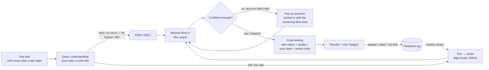

# Recommender v2 — "Tell me the vibe, I'll ask what I need"

Design for four requests, 2026-10-08:

1. Search for any film or show and rate it.
2. Ask a few questions to narrow the mood instead of needing a detailed prompt.
3. Match free text ("a chill movie after a late night") to films by *vibe*, learned from plots, keywords and reviews, not just genres.
4. Ask those questions as a skippable pop-up when the text is thin.

Scope: one viewer (profile "Me"). Partner support stays as-is and is not extended here.

---

## 0. The core idea in one picture



**Vibe space:** every film becomes a point in a 384-dimensional space. Its position comes from a paragraph describing it (plot, keywords, review snippets, mood tags). Films that *feel* alike end up close together. Your sentence is turned into a point in the same space, and the films nearest to it are the candidates. Then come the hard filters, your taste, and the questions.

---

## 1. Search to rate (small, buildable now)

**What you get:** a search box at the top of *💞 Rate Together*. Type 2+ letters, pick from a dropdown (poster, title, year, movie/TV), and the film opens as the current rating card with the same stars, "haven't seen it" and skip.

| Piece | Design |
|---|---|
| API | `GET /api/catalogue/search?q=<text>&media_type=movie\|tv\|all&limit=10` |
| Query | `title LIKE %q%` OR `original_title LIKE %q%`, ranked by: exact match → starts-with → `vote_count` desc. Accent/punctuation-insensitive (normalised title column or Python fallback). |
| Not in catalogue? | Show a "Not found — add from TMDB" row. That calls TMDB search and `upsert_catalogue_items`, needs internet, and works on your machine. |
| Frontend | Debounced input (250 ms), arrow-key navigation, Enter selects. The selected item is pushed to the front of the rating queue. |
| Tests | Exact / partial / accented titles, TV vs movie, unknown title. |

Nothing to prepare on your side.

---

## 2. Vibe search, the main goal

### 2.1 What each film "is", the vibe document

For each film we build one paragraph from these sources (best first):

| Source | Gives | Coverage | How we get it |
|---|---|---|---|
| Overview + tagline | What happens | ~100 % | Already stored (tagline: new) |
| TMDB keywords | "feel-good", "slow burn", "found family", "heist" | High for popular films | `GET /movie/{id}/keywords` → `tier2_keywords` (column exists, 0 % filled) |
| TMDB reviews | How it *feels* to watch, in viewers' words | Popular films only | `GET /movie/{id}/reviews` → 2–3 trimmed snippets → `tier2_reviews_summary` (exists) |
| Mood tags (optional, LLM) | energy, attention needed, emotional weight, darkness, pace, "good for: …" | 100 % | One-off batch job with an LLM over overview + keywords + reviews. Stored as `vibe_tags` |
| Your own notes | Your words | Your rated films | `watch_history.notes` (exists) |

Example vibe document:

> *Paddington 2. A bear takes odd jobs to buy a pop-up book, is framed for theft and rallies a prison to his side. Keywords: kindness, family, prison, heist, feel-good. Viewers: "pure joy", "made me smile the whole way through". Mood: gentle, low-stakes, warm, easy to follow, good for winding down.*

Why reviews and mood tags matter: plot summaries say what *happens*, but "chill after a late night" is about how a film *feels*. Keywords and reviews carry that feel. LLM mood tags fill it in for the long tail of films nobody reviewed.

No IMDb or Letterboxd review text. IMDb's public datasets have ratings only, and Letterboxd has no open API. Scraping either breaks their terms.

### 2.2 Turning text into vectors

- **Model:** `BAAI/bge-small-en-v1.5` (already used for TIGER Stage A). 33M parameters, 384-dimensional output, runs on a Pi as INT8 ONNX in tens of milliseconds per query.
- **Films:** embedded once offline → `models/vibe/item_vectors.npy` + `item_ids.json`. About 50k × 384 floats ≈ 75 MB fp32 or ~19 MB int8. Brute-force cosine search over 50k vectors is fast enough on a Pi without an index library.
- **Your text:** embedded at request time with bge's query prefix ("Represent this sentence for searching relevant passages: ").
- **Re-embed** whenever vibe documents change, or after fine-tuning (§5).

### 2.3 Vibe clusters (the "clusters" you asked about)

Group film vectors with k-means (k ≈ 80–150) into named clusters such as *"gentle comfort comedies"*, *"rainy-day Ghibli"*, *"slow-burn Korean revenge"* or *"big dumb fun action"*.

Names come from each cluster's most typical keywords, optionally polished by the LLM once.

Clusters are used for three things:
1. **Explanation:** "from your *gentle comfort comedies* cluster".
2. **Pop-up choices:** "More like… [cozy comedies] [warm dramas] [gentle animation]".
3. **Taste that doesn't saturate:** your affinity per cluster (liked minus disliked, shrunk by count). This replaces the genre tally that stops discriminating after ~50 ratings.

(TIGER's semantic IDs are already a 3-level clustering of the overview-only embeddings. They get rebuilt from the richer vibe vectors in Phase 5, so both systems share one map.)

### 2.4 Hard rules vs soft vibe

Some parts of a sentence are **rules** and must never be "roughly" satisfied. The rest is **vibe**.

| Kind | Examples | Handled by |
|---|---|---|
| Hard rules | "no horror", "under 2 hours", "Korean", "from the 90s", "something we haven't seen", "TV show" | Existing parsers (origin, exclusions, era, runtime) → SQL filters. Fix the known parser bugs first (substring countries, 1-word negation). |
| Soft vibe | "chill", "after a late night", "like They Live but funnier", "makes me feel hopeful" | Embedding similarity + facet scores |
| "Like <film>" | "something like Arrival" | That film's vector is blended into the query vector |

### 2.5 Facets: the dials behind the questions

Each film gets five 0–1 scores. They power both the pop-up and the ranking:

| Facet | Low end | High end |
|---|---|---|
| energy | calm, gentle | intense, adrenaline |
| attention | background-friendly, easy to follow | needs full focus, twisty |
| emotional weight | light, breezy | heavy, gut-punch |
| darkness | wholesome | violent, disturbing |
| pace | slow-burn | fast |

The question bank ([VIBE_QUESTION_BANK.md §4](VIBE_QUESTION_BANK.md#4-what-the-catalogue-needs-to-store)) adds nine more dials: **tension, ending_valence, humour, strangeness, cringe** (must-have), then **gore, fantasy, talkiness, spectacle**. It also adds content flags for the avoid questions, setting / season / time-of-day / palette / story-era tags, and closed "feels like" (37) and "good for" (16) vocabularies. Every dial has an anchor or keyword fallback, so questions work before LLM tags exist.

Two ways to fill them, both supported:
- **Free:** project the film's vector onto anchor sentences, e.g. `sim(film, "a calm, gentle, relaxing film") − sim(film, "an intense, adrenaline-filled film")`, rescaled to 0–1. No extra data needed, decent accuracy.
- **Better:** take them straight from the LLM mood tags (`utils/mood_tag.py`, Claude Haiku 5.5 via the Batch API; 200-film pilot first). When both exist, the LLM value wins and the anchor value is the fallback.

Your text gets the same projection. "After a late night" lands low on energy and attention without any hand-written rule.

### 2.6 Final score

```
score = 3.0 · vibe_similarity          (text ↔ film, 0–1)
      + 1.0 · facet_fit                (answers / inferred dials vs film's facets)
      + 0.6 · quality                  (Bayesian rating, rescaled 0–1)
      + 0.8 · cluster_affinity         (your taste per cluster, −1…+1)
      + 0.3 · next_watch               (TIGER's "what follows your recent films", 0–1)
then: hard filters → diversity (MMR on vibe vectors) → series order → paginate
```

The weights start hand-set. Once ~100 feedback events exist (§5), they are learned from what you actually play and rate (logistic regression, retrained weekly).

---

## 3. Questions pop-up (requests 2 and 4)

### Flow
1. You type anything, even one word, or nothing, and press **Find**.
2. If the request is thin, a pop-up asks **one question at a time, up to ~6** (you said you're happy to answer more, 2026-10-08). It stops earlier once the top results settle. Every screen has **Skip** and **Just show me**.
3. Answers update results live behind the pop-up, so you can stop the moment it looks right.
4. Questions already answered by your text are never asked. "Under 2 hours" means no length question.

### Question bank: "guess the vibe" (swapped in 2026-10-08)

The full bank lives in **[VIBE_QUESTION_BANK.md](VIBE_QUESTION_BANK.md)**: 33 questions in 9 groups, each option mapped to dial targets, hard filters and tag/keyword boosts, with "e.g." films, an adaptive picker, three sample sessions and a 10-question short set. It replaces the placeholder Q1–Q8 table that used to sit here.

The pop-up works like Akinator, but what it guesses is a feeling, not a film. Every question asks about **you and your evening** (your state, your surroundings, a sensation, an image), never about film attributes. Every answer still becomes something the ranker can measure.

**The vibe belief.** While you answer, the system keeps one target and one confidence (0–1) per dial, plus hard filters, tag boosts/penalties and query-vector nudges. `facet_fit` in §2.6 is `Σ conf · (1 − |film_dial − target|)`, so a dial nobody asked about has no effect.

| Group | What it finds out | Main dials | Questions |
|---|---|---|---|
| A | How much you've got left (tiredness, bandwidth, time) | attention, energy, runtime | A1 "Your brain right now is a…", A2 "Pick a seat", A3 "How did today end?", A4 "When does tonight end?" |
| B | What your heart needs | weight, ending_valence, feels | B1 "Pick a drink", B2 "Pick the last line of tonight's story", B3 "Put on a soundtrack", B4 "Who do you want to be for two hours?", B5 "Pick a swimming spot" |
| C | Comfort vs novelty | seen/unseen, cluster affinity, era, language, country | C1 "Pick a restaurant", C2 "Set the time machine", C3 "Reading tonight feels like…", C4 "Book a trip" |
| D | Who's there, what's happening around the screen | profile, attention, good_for | D1 "Who's on the sofa?", D2 "What's happening around the screen?", D3 "How should you two feel walking out?" |
| E | Tolerance for tension | darkness, tension, gore, cringe | E1 "Pick tomorrow's headline", E2 "A door is open a crack…", E3 "Awkward silences are…", E4 "Tonight's red is…" |
| F | Aesthetic and sensory mood | feels, setting, palette, talkiness, spectacle | F1 "Pick a window", F2 "Pick a colour palette", F3 "Stuck for a weekend", F4 "Pick a texture", F5 "Pick your dinner guest" |
| G | Pace and patience | pace | G1 "Pick a way to cross the river", G2 "If nothing happens for 20 minutes…" |
| H | What would ruin tonight (avoid) | content flags, caps on any dial | H1 "What would ruin tonight?", H2 "Which twist would make you throw the remote?", H3 "Last time it went wrong…", H4 "Had enough of anything lately?" |
| I | Closers built from the pool itself | query vector | I1 "Which of these feels closest?" (3 real clusters), I2 "This one or that one?" (2 real films) |

Example (A3, the default opener):

| Option | Changes |
|---|---|
| 🫠 Wrung out, too many people | `energy → 0.25` · `attention → 0.35 (weak)` · `feels+ quiet, solitary, dreamy` |
| 🥱 Bored, nothing happened | `energy → 0.75` · novelty +0.2 · `feels+ thrilling, chaotic` |
| 🌀 Stressed, head still buzzing | `darkness ≤ 0.4` · `tension ≤ 0.4` · `weight → 0.3` · `feels+ soothing, gentle` · `good_for+ winding down` |
| ✨ Great day, keep it going | `weight → 0.2` · `energy → 0.65` · `feels+ giddy, joyful` |

**The short set** (if only 10 questions ship first): A3, D1, A1, E1, B1, F1, C1, H1, A4, I1. All ten work on today's data. Next additions: E2, E3, G2.

### Choosing the next question (replaces the plain entropy rule)
Run after every answer ([bank §2](VIBE_QUESTION_BANK.md#2-choosing-the-next-question)):

1. **Eligible:** not asked, no **alt** sibling asked, its "Ask when" holds, and not already answered by your text ("with friends" answers D1).
2. **Hide dead options:** an option needs ≥ 10 films in the top 300 that fit it (avoid options must remove ≥ 5 % of the top 50). Fewer than 3 live options drops the question.
3. **Score** by simulating each option against the pool:
   ```
   value(q) = Σ_options p(option) · (1 − overlap(top10_now, top10_if_option))
            × fun(q)          # 1.2 for A3, D1, F1, F4, B1, E2
            × usefulness(q)   # learned, starts at 1.0
            × group_penalty   # 0.5 if the group was already asked
   ```
   `p(option)` starts uniform and later uses your past answers by weekday and hour. Below 0.3 (top 10 overlaps > 70 % whatever you pick) the question is dropped.
4. **Fixed slots:** question 1 is an "about you" question (A3, D1, A1, F1 or F4). One avoid question (H1/H2/H3) by question 4. Closers (I1, I2) only after question 4.
5. Ask the highest-scoring question.

**Stop** when the top 5 has been stable for two answers, there's a clear score gap between #5 and #6, 6 questions have been asked, or you press Skip / Just show me.

### What makes a question "meaningful" (decided 2026-10-08)
- **It must change the answer.** Before asking, simulate each option. If the top-10 results would overlap more than 70 % whichever option you pick, the question is dropped.
- **No dead options.** An option is only shown if at least 10 films in the current pool fit it.
- **Concrete over abstract.** Options show 2 example film posters from the pool ("🌙 Wind-down: *Paddington 2*, *Chef*"), so you choose by feel, not by label.
- **It learns which questions help.** Each question's usefulness is logged: did your answer move a film you then played into the top 5? Questions that rarely help sink in the ranking.

### When the pop-up appears
- **Auto:** when the text is short (< 6 meaningful words) or the top-20 results are spread across many clusters (ambiguous).
- **Never:** when you pressed "Just show me", or the text already fixes the facets.
- A settings toggle turns the pop-up off.

### API sketch
```
POST /api/discover/start   {query, profile}           -> {session_id, results, question?}
POST /api/discover/answer  {session_id, question_id, answer | "skip"} -> {results, question?}
POST /api/discover/finish  {session_id}                -> {results}
```
Session state (text, parsed rules, answers) is kept server-side and logged (§5).

---

## 4. Data model changes

| Table / file | New fields | Purpose |
|---|---|---|
| `media_items` | `tagline`, `vibe_tags` (JSON from the LLM tagger: 14 dials, content flags, feels / good_for / setting / season / time_of_day / palette / story_era), `facets` (JSON: the dials actually used for ranking, LLM value or anchor fallback), `vibe_cluster_id` | Vibe document parts + dials |
| `mood_tag_batches` (new) | `batch_id`, `created_at`, `item_ids`, `status`, `usage_json`, `cost_usd` | Lets the tagger resume and report real cost |
| `vibe_clusters` (new) | `id`, `label`, `size`, `top_keywords` | Named clusters |
| `discover_sessions` (new) | `id`, `created_at`, `profile_id`, `query_text`, `weekday`, `hour`, `answers_json` (keyed by question id + option id), `asked_order`, `rules_json`, `belief_json` | What you asked, and when |
| `discover_impressions` (new) | `session_id`, `media_item_id`, `rank`, `score_json`, `outcome` (shown/opened/dismissed/played/rated), `outcome_at`, `rating` | What happened, the training signal |
| `models/vibe/` | `encoder_int8.onnx`, `tokenizer.json`, `item_vectors.npy`, `item_ids.json`, `centroids.npy` | Runtime vibe engine |

---

## 5. How it gets better over time

| Loop | Signal | Cadence |
|---|---|---|
| Cluster affinity | Every rating | Instant |
| Ranking weights (§2.6) | Played or rated ≥ 7 = positive, dismissed or rated ≤ 4 = negative, per impression | Weekly |
| **Embedder fine-tune** | Triplets from your sessions: (your text, film you loved from it, film you dismissed from it). Uses the existing `train_mps.py` (MultipleNegativesRankingLoss) | Monthly, once ~100 triplets exist |
| TIGER retrain | Your liked-film sequence + MovieLens | Every ~20 new ratings (`training/retrain_tiger.sh`) |

Fine-tuning on your own triplets is what teaches the model what *you* mean by "chill". Your chill might be *The Grand Budapest Hotel*. Someone else's might be a nature documentary.

---

## 6. Build order

| Phase | What | Depends on | Size |
|---|---|---|---|
| 1 | Search to rate + feedback logging tables | – | Small |
| 2 | TMDB keywords + reviews + tagline backfill script; vibe documents | Phase 1 tables; you run the backfill | Small |
| 3 | Vibe engine: embed films, ONNX query encoder, retrieval, facets (anchor method), clusters + names; hard-rule parser fixes | Phase 2 data; you run the embedding job on the Mac | Medium |
| 4 | Questions pop-up (bank, entropy picker, live results, skip) | Phase 3 facets | Medium |
| 5 | Learning loops: cluster affinity, weight fitting, embedder fine-tune; rebuild TIGER semantic IDs from vibe vectors | Phase 4 logs accumulating | Medium |
| 6 | (Later) Day-of-week auto-downloads using the same scorer + weekday features | Phase 5 | Medium |

---

## 7. What you need to prepare

**Now (≈ 1 hour of machine time, minutes of yours):**
1. `git push` (commits are waiting locally).
2. `uv run python utils/backfill_collections.py`: series order data.
3. `bash training/retrain_tiger.sh`: retrains the "what next" model on your liked films + MovieLens.

**The most valuable thing only you can make: a test set.**
4. Write **30–50 prompts the way you'd really type them**, each with 2–5 films you'd be happy to get and 1–2 you'd hate. For example:
   `"chill movie after a late night" → good: Paddington 2, Chef, Amélie · bad: Se7en`
   Put them in `training/vibe_eval.csv` (`prompt,good_titles,bad_titles`).
   This lets us *measure* whether vibe search works (how many of your good films land in the top 10) instead of guessing. Later it becomes fine-tuning data. Mix short prompts ("cozy") with long ones, and include moods, occasions ("sunday hangover"), references ("like Arrival but lighter") and hard rules ("no subtitles").

**Decisions (2026-10-08):**
5. **LLM mood tags: yes** (2026-10-08). Claude Haiku 5.5 via the Batch API, using the dials, flags and vocabularies from the question bank §4. A 200-film pilot runs first; the full catalogue only runs after you've seen the real pilot cost and sample tags.
6. **Where it runs: decided.** Train on the Mac; serve on the Pi. The query encoder ships as INT8 ONNX. Film vectors are precomputed on the Mac and copied to the Pi. No torch on the Pi.
7. **Pop-up: decided.** It appears automatically. Questions must be *meaningful*: each one is chosen because its answers split the current candidates into clearly different films (§3). If no remaining question would change the top 10, the pop-up doesn't appear. Answer options are written from the candidates themselves where possible, e.g. Q8 offers the 3 clusters actually present in the pool, so every choice leads somewhere real.

**Keep doing:**
8. Rate films, especially ones you *disliked*, since negative signal is currently missing. Use "not this one" in results: once logging exists, every tap is training data.
