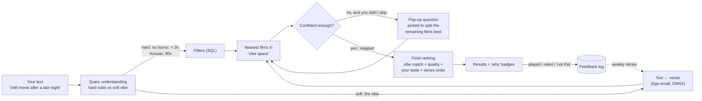

# Recommender v2 — "Tell me the vibe, I'll ask what I need"

Design for four requests, 2026-10-08:

1. Search for any film or show and rate it.
2. Ask a few questions to narrow the mood instead of needing a detailed prompt.
3. Match free text ("a chill movie after a late night") to films by *vibe*, learned from plots, keywords and reviews, not just genres.
4. Ask those questions as a skippable pop-up when the text is thin.

Scope: one viewer (profile "Me"). Partner support stays as-is and is not extended here.

---

## 0. The core idea in one picture



**Vibe space:** every film becomes a point in a 384-dimensional space. Its position comes from a paragraph describing it (plot, keywords, review snippets, mood tags). Films that *feel* alike end up close together. Your sentence is turned into a point in the same space, and the films nearest to it are the candidates. Then come the hard filters, your taste, and the questions.

---

## 1. Search to rate (small, buildable now)

**What you get:** a search box at the top of *💞 Rate Together*. Type 2+ letters, pick from a dropdown (poster, title, year, movie/TV), and the film opens as the current rating card with the same stars, "haven't seen it" and skip.

| Piece | Design |
|---|---|
| API | `GET /api/catalogue/search?q=<text>&media_type=movie\|tv\|all&limit=10` |
| Query | `title LIKE %q%` OR `original_title LIKE %q%`, ranked by: exact match → starts-with → `vote_count` desc. Accent/punctuation-insensitive (normalised title column or Python fallback). |
| Not in catalogue? | Show a "Not found — add from TMDB" row. That calls TMDB search and `upsert_catalogue_items`, needs internet, and works on your machine. |
| Frontend | Debounced input (250 ms), arrow-key navigation, Enter selects. The selected item is pushed to the front of the rating queue. |
| Tests | Exact / partial / accented titles, TV vs movie, unknown title. |

Nothing to prepare on your side.

---

## 2. Vibe search, the main goal

### 2.1 What each film "is", the vibe document

For each film we build one paragraph from these sources (best first):

| Source | Gives | Coverage | How we get it |
|---|---|---|---|
| Overview + tagline | What happens | ~100 % | Already stored (tagline: new) |
| TMDB keywords | "feel-good", "slow burn", "found family", "heist" | High for popular films | `GET /movie/{id}/keywords` → `tier2_keywords` (column exists, 0 % filled) |
| TMDB reviews | How it *feels* to watch, in viewers' words | Popular films only | `GET /movie/{id}/reviews` → 2–3 trimmed snippets → `tier2_reviews_summary` (exists) |
| Mood tags (optional, LLM) | energy, attention needed, emotional weight, darkness, pace, "good for: …" | 100 % | One-off batch job with an LLM over overview + keywords + reviews. Stored as `vibe_tags` |
| Your own notes | Your words | Your rated films | `watch_history.notes` (exists) |

Example vibe document:

> *Paddington 2. A bear takes odd jobs to buy a pop-up book, is framed for theft and rallies a prison to his side. Keywords: kindness, family, prison, heist, feel-good. Viewers: "pure joy", "made me smile the whole way through". Mood: gentle, low-stakes, warm, easy to follow, good for winding down.*

Why reviews and mood tags matter: plot summaries say what *happens*, but "chill after a late night" is about how a film *feels*. Keywords and reviews carry that feel. LLM mood tags fill it in for the long tail of films nobody reviewed.

No IMDb or Letterboxd review text. IMDb's public datasets have ratings only, and Letterboxd has no open API. Scraping either breaks their terms.

### 2.2 Turning text into vectors

- **Model:** `BAAI/bge-small-en-v1.5` (already used for TIGER Stage A). 33M parameters, 384-dimensional output, runs on a Pi as INT8 ONNX in tens of milliseconds per query.
- **Films:** embedded once offline → `models/vibe/item_vectors.npy` + `item_ids.json`. About 50k × 384 floats ≈ 75 MB fp32 or ~19 MB int8. Brute-force cosine search over 50k vectors is fast enough on a Pi without an index library.
- **Your text:** embedded at request time with bge's query prefix ("Represent this sentence for searching relevant passages: ").
- **Re-embed** whenever vibe documents change, or after fine-tuning (§5).

### 2.3 Vibe clusters (the "clusters" you asked about)

Group film vectors with k-means (k ≈ 80–150) into named clusters such as *"gentle comfort comedies"*, *"rainy-day Ghibli"*, *"slow-burn Korean revenge"* or *"big dumb fun action"*.

Names come from each cluster's most typical keywords, optionally polished by the LLM once.

Clusters are used for three things:
1. **Explanation:** "from your *gentle comfort comedies* cluster".
2. **Pop-up choices:** "More like… [cozy comedies] [warm dramas] [gentle animation]".
3. **Taste that doesn't saturate:** your affinity per cluster (liked minus disliked, shrunk by count). This replaces the genre tally that stops discriminating after ~50 ratings.

(TIGER's semantic IDs are already a 3-level clustering of the overview-only embeddings. They get rebuilt from the richer vibe vectors in Phase 5, so both systems share one map.)

### 2.4 Hard rules vs soft vibe

Some parts of a sentence are **rules** and must never be "roughly" satisfied. The rest is **vibe**.

| Kind | Examples | Handled by |
|---|---|---|
| Hard rules | "no horror", "under 2 hours", "Korean", "from the 90s", "something we haven't seen", "TV show" | Existing parsers (origin, exclusions, era, runtime) → SQL filters. Fix the known parser bugs first (substring countries, 1-word negation). |
| Soft vibe | "chill", "after a late night", "like They Live but funnier", "makes me feel hopeful" | Embedding similarity + facet scores |
| "Like <film>" | "something like Arrival" | That film's vector is blended into the query vector |

### 2.5 Facets: the dials behind the questions

Each film gets five 0–1 scores. They power both the pop-up and the ranking:

| Facet | Low end | High end |
|---|---|---|
| energy | calm, gentle | intense, adrenaline |
| attention | background-friendly, easy to follow | needs full focus, twisty |
| emotional weight | light, breezy | heavy, gut-punch |
| darkness | wholesome | violent, disturbing |
| pace | slow-burn | fast |

Two ways to fill them, both supported:
- **Free:** project the film's vector onto anchor sentences, e.g. `sim(film, "a calm, gentle, relaxing film") − sim(film, "an intense, adrenaline-filled film")`, rescaled to 0–1. No extra data needed, decent accuracy.
- **Better (optional):** take them straight from the LLM mood tags.

Your text gets the same projection. "After a late night" lands low on energy and attention without any hand-written rule.

### 2.6 Final score

```
score = 3.0 · vibe_similarity          (text ↔ film, 0–1)
      + 1.0 · facet_fit                (answers / inferred dials vs film's facets)
      + 0.6 · quality                  (Bayesian rating, rescaled 0–1)
      + 0.8 · cluster_affinity         (your taste per cluster, −1…+1)
      + 0.3 · next_watch               (TIGER's "what follows your recent films", 0–1)
then: hard filters → diversity (MMR on vibe vectors) → series order → paginate
```

The weights start hand-set. Once ~100 feedback events exist (§5), they are learned from what you actually play and rate (logistic regression, retrained weekly).

---

## 3. Questions pop-up (requests 2 and 4)

### Flow
1. You type anything, even one word, or nothing, and press **Find**.
2. If the request is thin, a pop-up asks **one question at a time, up to ~6** (you said you're happy to answer more, 2026-10-08). It stops earlier once the top results settle. Every screen has **Skip** and **Just show me**.
3. Answers update results live behind the pop-up, so you can stop the moment it looks right.
4. Questions already answered by your text are never asked. "Under 2 hours" means no length question.

### Question bank (each answer maps to facets / filters)

> **Placeholder, to be replaced.** These questions were judged not insightful enough (2026-10-08). A better bank is being written in a separate chat: indirect, "guess the vibe" questions about your state and situation rather than film attributes. Swap it in when it's ready.

| # | Question | Answers → effect |
|---|---|---|
| Q1 | How much brain have you got tonight? | 🛋️ Barely any → attention low · 🙂 Some → mid · 🧠 Full focus → high |
| Q2 | What energy? | 🌙 Wind-down → energy low · ⚖️ In between · ⚡ Wake me up → high |
| Q3 | How do you want to feel after? | 😊 Lighter · 🥲 A good cry is fine · 🤯 Mind blown · 😱 Scared |
| Q4 | Darkness limit? | ☀️ Keep it wholesome · 🌗 Some edge · 🌑 Anything goes |
| Q5 | How long have you got? | < 100 min · ~2 h · Epic is fine · It's a TV night |
| Q6 | New or comfort? | ✨ Something new · 🔁 A favourite rewatch · 🧭 Surprise me |
| Q7 | Subtitles OK? | Yes · Prefer English |
| Q8 | More like…? | 3 cluster names closest to your text (§2.3) |

### Which question to ask: "20 questions"
Take the top ~300 films matching the text so far. For each unanswered question, check how its answers would split those films (via their facets). **Ask the question whose answers split the pool most evenly** (highest entropy). That is the question you learn most from.

Stop when:
- the top results are clearly ahead (big score gap), or
- ~6 questions have been asked, or
- you skip.

The same idea powers the game *Guess Who?*: "does your person wear glasses?" beats "is your person called Bernard?".

### What makes a question "meaningful" (decided 2026-10-08)
- **It must change the answer.** Before asking, simulate each option. If the top-10 results would overlap more than 70 % whichever option you pick, the question is dropped.
- **No dead options.** An option is only shown if at least 10 films in the current pool fit it.
- **Concrete over abstract.** Options show 2 example film posters from the pool ("🌙 Wind-down: *Paddington 2*, *Chef*"), so you choose by feel, not by label.
- **It learns which questions help.** Each question's usefulness is logged: did your answer move a film you then played into the top 5? Questions that rarely help sink in the ranking.

### When the pop-up appears
- **Auto:** when the text is short (< 6 meaningful words) or the top-20 results are spread across many clusters (ambiguous).
- **Never:** when you pressed "Just show me", or the text already fixes the facets.
- A settings toggle turns the pop-up off.

### API sketch
```
POST /api/discover/start   {query, profile}           -> {session_id, results, question?}
POST /api/discover/answer  {session_id, question_id, answer | "skip"} -> {results, question?}
POST /api/discover/finish  {session_id}                -> {results}
```
Session state (text, parsed rules, answers) is kept server-side and logged (§5).

---

## 4. Data model changes

| Table / file | New fields | Purpose |
|---|---|---|
| `media_items` | `tagline`, `vibe_tags` (JSON), `facets` (JSON: energy, attention, weight, darkness, pace), `vibe_cluster_id` | Vibe document parts + dials |
| `vibe_clusters` (new) | `id`, `label`, `size`, `top_keywords` | Named clusters |
| `discover_sessions` (new) | `id`, `created_at`, `profile_id`, `query_text`, `answers_json`, `rules_json` | What you asked |
| `discover_impressions` (new) | `session_id`, `media_item_id`, `rank`, `score_json`, `outcome` (shown/opened/dismissed/played/rated), `outcome_at`, `rating` | What happened, the training signal |
| `models/vibe/` | `encoder_int8.onnx`, `tokenizer.json`, `item_vectors.npy`, `item_ids.json`, `centroids.npy` | Runtime vibe engine |

---

## 5. How it gets better over time

| Loop | Signal | Cadence |
|---|---|---|
| Cluster affinity | Every rating | Instant |
| Ranking weights (§2.6) | Played or rated ≥ 7 = positive, dismissed or rated ≤ 4 = negative, per impression | Weekly |
| **Embedder fine-tune** | Triplets from your sessions: (your text, film you loved from it, film you dismissed from it). Uses the existing `train_mps.py` (MultipleNegativesRankingLoss) | Monthly, once ~100 triplets exist |
| TIGER retrain | Your liked-film sequence + MovieLens | Every ~20 new ratings (`training/retrain_tiger.sh`) |

Fine-tuning on your own triplets is what teaches the model what *you* mean by "chill". Your chill might be *The Grand Budapest Hotel*. Someone else's might be a nature documentary.

---

## 6. Build order

| Phase | What | Depends on | Size |
|---|---|---|---|
| 1 | Search to rate + feedback logging tables | – | Small |
| 2 | TMDB keywords + reviews + tagline backfill script; vibe documents | Phase 1 tables; you run the backfill | Small |
| 3 | Vibe engine: embed films, ONNX query encoder, retrieval, facets (anchor method), clusters + names; hard-rule parser fixes | Phase 2 data; you run the embedding job on the Mac | Medium |
| 4 | Questions pop-up (bank, entropy picker, live results, skip) | Phase 3 facets | Medium |
| 5 | Learning loops: cluster affinity, weight fitting, embedder fine-tune; rebuild TIGER semantic IDs from vibe vectors | Phase 4 logs accumulating | Medium |
| 6 | (Later) Day-of-week auto-downloads using the same scorer + weekday features | Phase 5 | Medium |

---

## 7. What you need to prepare

**Now (≈ 1 hour of machine time, minutes of yours):**
1. `git push` (commits are waiting locally).
2. `uv run python utils/backfill_collections.py`: series order data.
3. `bash training/retrain_tiger.sh`: retrains the "what next" model on your liked films + MovieLens.

**The most valuable thing only you can make: a test set.**
4. Write **30–50 prompts the way you'd really type them**, each with 2–5 films you'd be happy to get and 1–2 you'd hate. For example:
   `"chill movie after a late night" → good: Paddington 2, Chef, Amélie · bad: Se7en`
   Put them in `training/vibe_eval.csv` (`prompt,good_titles,bad_titles`).
   This lets us *measure* whether vibe search works (how many of your good films land in the top 10) instead of guessing. Later it becomes fine-tuning data. Mix short prompts ("cozy") with long ones, and include moods, occasions ("sunday hangover"), references ("like Arrival but lighter") and hard rules ("no subtitles").

**Decisions (2026-10-08):**
5. **LLM mood tags:** *open.* Pilot on 200 films and estimate the cost first if yes.
6. **Where it runs: decided.** Train on the Mac; serve on the Pi. The query encoder ships as INT8 ONNX. Film vectors are precomputed on the Mac and copied to the Pi. No torch on the Pi.
7. **Pop-up: decided.** It appears automatically. Questions must be *meaningful*: each one is chosen because its answers split the current candidates into clearly different films (§3). If no remaining question would change the top 10, the pop-up doesn't appear. Answer options are written from the candidates themselves where possible, e.g. Q8 offers the 3 clusters actually present in the pool, so every choice leads somewhere real.

**Keep doing:**
8. Rate films, especially ones you *disliked*, since negative signal is currently missing. Use "not this one" in results: once logging exists, every tap is training data.
