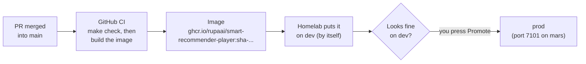

# Deployment: how code gets onto the server

The app runs in Docker on the home server (**mars**), managed by **Homelab**, a small
self-hosted tool (its own repo, `rupaai/homelab`) that runs apps, their helper services,
secrets and two copies of each app: **dev** (for trying a build) and **prod** (what you use).

## From a merged PR to the TV



1. **CI** (`.github/workflows/ci.yml`) runs `make check` on every PR. On `main` it then builds
   the server image from the `Dockerfile` and pushes it, tagged with the commit.
2. **Homelab** sees the new image and puts it on **dev** by itself (`promotion: auto-dev`).
3. You try dev. When happy, press **Promote** in the Homelab companion. Prod switches over.
4. The TV app is separate: its own CI job builds it, and the TV updates itself
   ([TV app](tv-app.md)).

Never copy code to mars or restart containers by hand: everything goes through a merge.

## The files

| File | What it says |
|---|---|
| `homelab.yaml` | the app for Homelab: image, port 8000 inside the container, data folders (`/data`, `/models`), the media folder (`/media`), memory cap (2 GB), secrets, and the helper services |
| `homelab/config.yaml` | the app's settings on mars: people, `/media` paths, `engine: wishmatch`, 500 GB media cap, watched cleanup in dry run. It is built into the image, so changing it needs a PR. |
| `Dockerfile` | what goes into the image (Python 3.12, `uv`, the code folders) |

**Helper services** (also in `homelab.yaml`): **Jellyfin** (plays the files, uses the Intel
graphics for conversion), **Prowlarr** (download search), **Ollama** (the wish reader; 3 GB
memory cap; only prod downloads the model). Dev gets its own empty copies.

Home Assistant and Matter also run on mars. Nothing here may touch them.

## Secrets

The TMDB key, Jellyfin key and user, and Prowlarr key are typed once into the Homelab
companion (Apps, Northern Lights, Secrets). They reach the app as files in `/run/secrets`,
which `services/homelab_secrets.py` reads at start-up. `ADMIN_TOKEN` (for the Mac's Train
button) is made by Homelab; copy it from the same screen. After changing a secret, restart
prod. Secrets are never in the repo, the logs or the settings files.

## Where the data lives on mars

| What | Where |
|---|---|
| database (ratings, history, catalogue) | `/data/catalogue_full.db` (Homelab's data volume, one per environment) |
| model files from the Train button | `/models/current` -> `/models/releases/<bundle>` (the last 3 are kept) |
| films and shows | `/media/Movies`, `/media/Shows` (an external SSD at `/mnt/storage`) |
| downloads in progress | `/media/downloads` |

## Checking and fixing

- **Is it up?** `http://<server>:7101/healthz` shows the version and the model bundle.
- **Logs:** Homelab's Logs page (the app writes one JSON line per message).
- **A bad build:** promote the previous version in Homelab.
- **A bad model:** `python3 ops/mac/cc.py rollback-model` on the Mac.
- **Reaching mars:** `ssh rupaai@192.168.1.183` on the home network. Ask before changing
  anything there.

## Running it somewhere else

The app is a normal Docker image, so it can run without Homelab:

1. Run Jellyfin (and optionally Prowlarr and Ollama) on the same machine.
2. Start the image with port 8000, a data folder for the database, your media folder, and
   the environment variables `TMDB_API_KEY`, `JELLYFIN_URL`, `JELLYFIN_API_KEY`,
   `CONFIG_PATH` (your settings file), `DATABASE_PATH` and optionally `OLLAMA_URL`.
3. Put your people and folders in your settings file (see `config.local.example.yaml`).

Or, without Docker: `uv sync`, then `uv run python server.py` and open
`http://localhost:8000`.

## History: removing the old setup on mars

Before Homelab, the app ran as "couchcinema" with its own scripts. If any of it is still on
mars, these remove it (safe to run twice):

```bash
U=$(id -u deploy); sudo -u deploy XDG_RUNTIME_DIR=/run/user/$U DOCKER_HOST=unix:///run/user/$U/docker.sock docker compose -p couchcinema -f /srv/couchcinema/compose.yaml down
sudo rm -f /etc/cron.d/couchcinema
sudo systemctl disable --now actions.runner.rupaai-smart-recommender-player.mars
sudo rm -f /etc/systemd/system/actions.runner.rupaai-smart-recommender-player.mars.service
sudo systemctl daemon-reload
```
