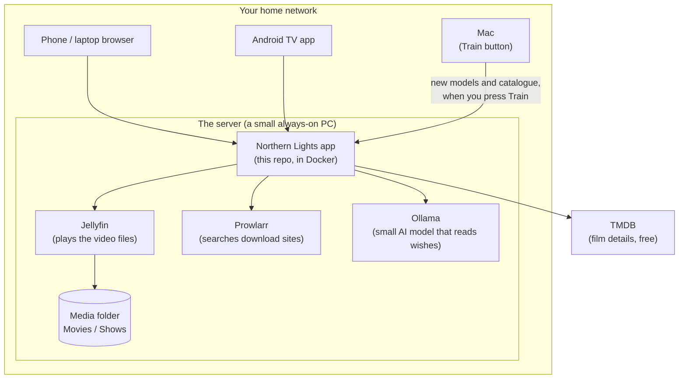

# Overview

**Northern Lights** is a self-hosted film and TV app for a household (built for two
people watching together, but it works for one). It:

- finds and downloads films and shows,
- plays them on a phone, laptop, Android TV or Chromecast, at original quality where it can,
- remembers everything each person watched and how they liked it,
- recommends what to watch from a typed wish ("something funny but not silly"), alone or together.

It runs on your own computer at home. Nothing is sent to a cloud service except lookups to
TMDB (film details) and, optionally, a paid AI tagging run you choose to start.

## The pieces

- **The app** (this repository) is the brain: pages, recommendations, downloads, who is watching.
- **Jellyfin** is a free media server. The app never streams video itself; it asks Jellyfin
  for the right stream and passes it on. You don't need to use Jellyfin's own apps.
- **Prowlarr** (optional) searches several download sites at once.
- **Ollama** runs a small open AI model on the server's processor to understand typed wishes. Free.
- **The Mac** does the heavy, occasional work (building search indexes, tagging new titles)
  when you press the Train button, then sends the results to the server.

In our home the server is **mars**, a Dell OptiPlex (i5, 16 GB, no graphics card) under
[Homelab](deployment.md), and the Mac is an M3 MacBook Air.

## The catalogue

The app keeps one database file (`catalogue_full.db`, SQLite) with about 50,000 films and
shows from TMDB, whether or not you have them. That is what recommendations choose from.
Next to each title it keeps:

- TMDB facts (genres, year, rating, vote count, plot, cast),
- **mood tags**: a short description of how a title feels (funny, tense, cosy...) and 14
  "dials" (how dark, how fast, how funny, from 0 to 1). 48,260 titles were tagged once by
  Claude Haiku in October 2026 (it cost $5.30). New titles get free tags from Gemma on the Mac.
- what each person watched, their verdict (rewatch, loved, liked, meh, not for me) and the
  files you have.

## A night in, step by step

1. **Who's watching?** The TV or phone asks once: Labiba, Gabriele, or Both of us. That
   picks whose progress, settings and tastes count.
2. **The wish.** You type "something funny and short", or tap a mood card.
3. **Wishmatch** reads the wish, picks about 2,000 well-known candidates, maybe asks one or
   two questions ("silly or witty?"), and ranks them by how well they fit the wish and your
   tastes. See [Wishmatch](wishmatch.md).
4. **Getting it.** If you don't have the title yet, the Download page searches, ranks the
   copies ("Best match": quality, how many people share it, sensible size) and downloads it
   into the media folder in Jellyfin's naming, then tells Jellyfin to look.
5. **Playing.** The player asks the server how to play the file on this screen. The TV gets
   the original file untouched. See [Playback](playback.md).
6. **Afterwards.** "How was it?" asks each person for a verdict. That feeds the next picks.
   A film everyone watched more than a week ago can be cleaned up to save space (off until
   you switch it on).

## The two apps in one

- **The original app** (`/`): tabs Discover, Download, Rate, Later, History. Rating lives here.
- **Northern Lights** (`/nl/` on the phone, `/nl/tv/` on the TV, `/player/` on a laptop):
  the library and the player.

Both use the same server and database.
