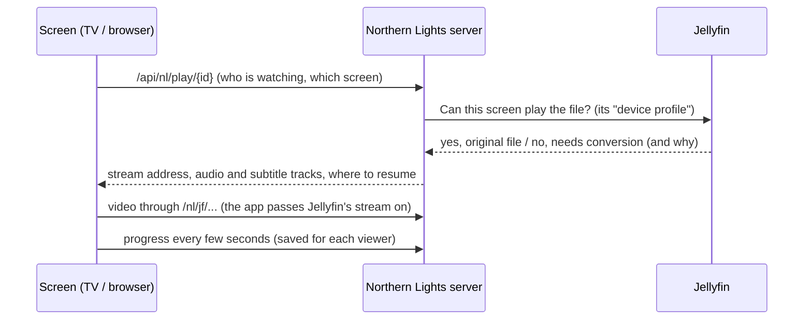

# Playback: how a film gets to the screen

The goal: play big films (an 80 GB "remux", a straight copy of a Blu-ray) at **original
quality, with no conversion**, on the TV.

Two words first:
- **Original file** (also "direct play"): the screen gets the file exactly as it is on disk.
  Best picture and sound, almost no work for the server.
- **Converted copy** (also "transcoding"): Jellyfin re-encodes the video or sound on the fly
  into something the screen can play. Lower quality, and heavy for the server's processor.

## What happens when you press Play

- The **device profile** (`services/device_profiles.py`) lists what each kind of screen can
  play: video and audio formats, top bitrate. There are profiles for the browser (built from
  what the browser says it supports), the laptop (up to 400 Mbps), the TV (up to 400 Mbps,
  every lossless audio format) and the Chromecast.
- The screen never sees Jellyfin's key, user ids or file paths. Everything goes through the
  app, and `/nl/jf/` only lets through video, subtitles, thumbnails and artwork.

## On the TV: always the original

The TV app asks for the original file every time. The TV's own player (Media3, Google's
Android video player) plays it, with the extra pieces needed for remuxes:

- **Sound:** Dolby TrueHD, DTS-HD and other lossless formats are decoded on the TV by an
  FFmpeg add-on, or passed untouched to a sound system that takes them. On TV speakers,
  surround is mixed down to stereo with the dialogue kept clear.
- **Picture:** Dolby Vision profile 7 (common on UHD Blu-ray remuxes) plays as its HDR10 base
  layer. The TV switches its refresh rate to match the film (24 fps films play at 24 Hz).
- **Subtitles inside the file** (text, or disc pictures like PGS) are drawn by the TV app
  from the file it is already playing, so Jellyfin doesn't have to read the whole 80 GB file
  to pull them out. Size, background, position and delay settings work on all of them.
- **Buffering:** the TV keeps about 15 seconds ahead in memory for a 92 Mbps remux (the TV
  has only 1.8 GB of memory). The home Wi-Fi measured 294 Mbps, plenty for that.

If Jellyfin says the TV can't take the original (rare), the player says why and offers
**Play a converted copy (lower quality)**. It never converts without asking.

## In a browser or on a laptop

- **Laptop** (`/player/`): sends the video untouched or only repackaged; converts the sound
  only when the browser can't play it (to FLAC or stereo AAC). Anything that would re-encode
  the video asks first.
- **Phone / browser** (`/nl/`): may convert, within the quality cap set on the me page.
- **Chromecast:** gets a signed, short-lived link to the stream.

## Audio and subtitle choice

- Each person sets preferred audio and subtitle languages and the subtitle look (me page).
- Every pick you make in the player (including "Off") is **remembered per person and per
  film or show**, and wins next time. Another episode gets the closest match (same language,
  same kind: forced, SDH, commentary).
- **Forced subtitles** (only the foreign-language bits) switch on by themselves when the
  audio is in another language.
- **Find subtitles** searches OpenSubtitles through Jellyfin's plugin and adds the file.
- A picture subtitle in its **own file** next to the film (`.idx/.sub`, `.sup`) can't be
  drawn over the TV's original file yet. The TV asks: find a text one, play a converted
  copy, or keep the original without it.

## Player extras

Thumbnails on the seek bar, chapters, skip intro/credits (needs Jellyfin's Intro Skipper
plugin), playback speed, "Ends at" clock, and on the TV a **Playback info** panel (Picture
menu) showing whether it plays the original, the decoder, dropped frames, buffer and memory.

## When something goes wrong

| You see | Likely cause |
|---|---|
| "Can't reach the movie server. Is the server on?" | the server or Jellyfin is down |
| a "Play a converted copy" button | Jellyfin can't send the original to this screen; the reason is on the card |
| a subtitle stuck on "(loading)" | a picture subtitle file on the TV (see above) |
| stutter on a huge file | check Playback info: buffer and bandwidth |

## Where it lives

Server: `services/jellyfin_playback.py`, `services/device_profiles.py`,
`services/nl_track_memory.py`, `services/nl_player_extras.py`, routes in
`web/routes/nl_play.py`. Pages: `static/nl/player-core.js` (the only file that touches the
video or the TV bridge), `player.js`, `subtitles.js`. TV side: see [TV app](tv-app.md).
