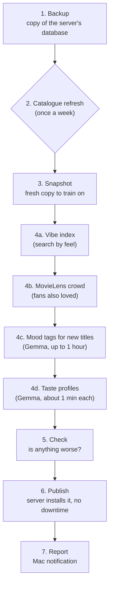

# Training and tagging (the Train button)

Some work is too heavy for the server, which has no graphics card: building the search
index, tagging new titles with mood words, writing taste profiles. The **Mac** does it when
you press **Train CouchCinema** (in `~/Applications`), then sends the results to the server.
Nothing runs on a schedule (the Mac is off at night). A run takes 10 to 80 minutes.

**Cost: free.** Everything uses the Mac's own processor and free, open models. The only paid
options (Claude Haiku) are off unless you start them by hand, and the command says the cost
first.

## What one run does

| Step | What and why |
|---|---|
| 1 Backup | Downloads the server's database (ratings, history) to `~/CouchCinemaBackups/`. Kept 30 days. |
| 2 Catalogue | Once a week: looks for new titles on TMDB, keeps only those with at least 200 votes and a 6.0 rating (`nightly:` in `config.yaml`), and sends them to the server. Titles are never removed. |
| 3 Snapshot | Downloads the database again so the models use the server's own title ids. |
| 4a Vibe index | Turns each title's "vibe document" (plot, tags, mood words) into numbers with a small text model (bge-small), works out the 14 mood dials for titles without tags, and groups titles into "vibe clusters". Used by vibe search and the taste model. |
| 4b Crowd | From MovieLens (610 people's public ratings): for each film, the 30 films its fans also rated highly. Wishmatch uses it for "fans of X loved it". |
| 4c Mood tags | New titles get feelings, occasions and dials from **Gemma 3 4B** in Ollama on the Mac. About 40-60 seconds a title, best-known first, for at most an hour a run (`nightly.mood_tag_minutes`). The rest wait for the next run. |
| 4d Taste profiles | A short written summary of each person's taste, plus the feelings they like and avoid (worked out from their ratings). Pushed to the server. A profile you edited by hand is never overwritten. |
| 5 Check | Scores the taste model on your ratings. If a score fell more than 1% (`nightly.gate_max_drop_pct`), the new bundle is held back. With nothing to compare yet, it goes through. |
| 6 Publish | Packs everything into a **model bundle** and sends it. The server checks the files, that every title id exists, and that the model loads, then switches over in one step. |

Nothing here can delete films or ratings: the server never removes titles, and the Mac
never sends watch history back.

## Tags: why they matter

Mood tags are how Wishmatch knows what a title *feels* like. In October 2026, 48,260 titles
were tagged once by **Claude Haiku** for $5.30. Since then new titles use the free Gemma
model. A comparison of 100 titles ("bake-off") found Gemma 3 4B closest to Haiku among the
free models that fit in 16 GB: dials within about 0.12 on a 0-1 scale, feelings sharing about
2 of 5 words. Haiku is still better, at about 1 cent per 100 titles, if you ever want it
(`utils/mood_tag.py`, which prints the cost and waits for `--yes`).

## Doing it by hand

| I want to... | On the Mac, in the project folder |
|---|---|
| install the button | `bash ops/mac/install.sh` (asks the server address and admin token) |
| train now | `bash ops/mac/train-now.sh` |
| train but not publish | `bash ops/mac/nightly.sh --skip-catalogue --skip-publish` |
| refresh the catalogue now | `bash ops/mac/nightly.sh --catalogue` |
| see which model the server runs | `python3 ops/mac/cc.py model-status` |
| go back to the previous model | `python3 ops/mac/cc.py rollback-model` |
| see today's log | `cat ~/Library/Logs/CouchCinema/$(date +%F).log` |

More detail and troubleshooting: `ops/mac/README.md`. The scripts themselves:
`training/README.md`.

## Where it lives

`ops/mac/nightly.sh` (the steps), `ops/mac/cc.py` (talks to the server's `/admin` API),
`ops/mac/pipeline.py` (settings and the check), `training/build_vibe_index.py`,
`training/build_wishmatch_crowd.py`, `utils/mood_tag_ollama.py`, `utils/wishmatch_profiles.py`,
`utils/build_full_catalogue.py`. On the server: `services/model_bundle.py`,
`services/catalogue_patch.py`.
