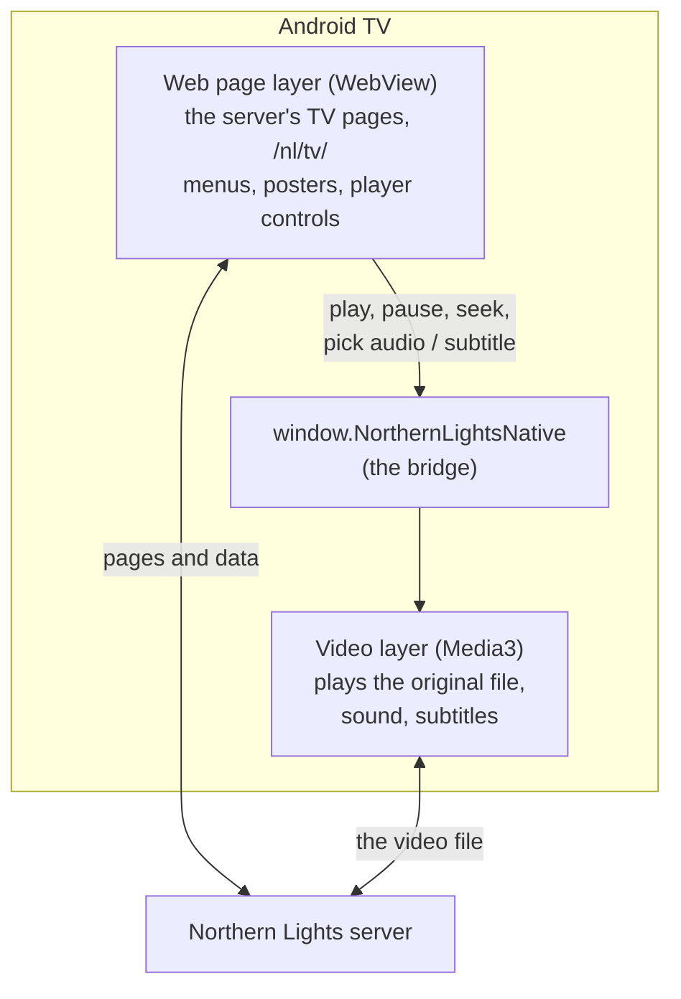

# The TV app

An Android TV app (`tv-app/`, written in Kotlin). It is two layers on top of each other:

- The **pages** (home, title, show, search, player controls) are ordinary web pages from the
  server. Changing them needs only a server deploy, not a new TV app.
- The **video** plays in Media3 underneath the page, so the TV's own hardware decodes it.
  The page talks to it through the **bridge**, a small list of calls (`NativeBridge.kt`).
  The bridge has a version number (now 7); the page checks it, so an older app keeps working
  with fewer features.

Only a change to the Kotlin code needs a new app. Everything else is a server change.

## Installing (once)

1. Download the newest `northern-lights-tv.apk` from the repository's **tv-app** release
   (GitHub, Releases, "tv-app").
2. Turn on developer mode on the TV: Settings, System, About, press **Android TV OS build** 7
   times. Then turn on USB debugging (and Wireless debugging) in Developer options.
3. From a computer on the same Wi-Fi: `adb connect <tv-ip>:5555`, then
   `adb install -r northern-lights-tv.apk`. (On the Mac: `brew install android-platform-tools`.)
4. Open Northern Lights on the TV and type the server's address, for example
   `http://192.168.1.183:7101`.

## Updates

After that, the app updates itself. Every build of `main` is published to the `tv-app`
release. Each time you come back to the app (never during a film), it checks for a newer
version, downloads it and Android asks you to OK the install. The first time, Android asks to
allow installs from Northern Lights. You can also check from the me page: **TV app: server
address and updates**. The version shows in the TV's Settings, Apps, as `1.0.<build number>`.

## Using it with the remote

- Arrows move the focus (a soft cyan ring), OK opens. The bar has Home, Downloads, Search, and
  your initial in the corner (who is watching).
- **Search:** type with the remote, or scan the QR code and type on your phone.
- **In the player:** OK shows the controls, left/right skip (quick presses add up into one
  jump), Back hides the controls, then asks "Press Back again to stop watching".
- **Audio, subtitles, picture** menus are in the player controls. "Playback info..." in the
  Picture menu shows how the film is playing (original or converted, decoder, buffer).

## The look

The TV pages use the "soft aurora" look: deep navy background with three faint glows, DM
Sans, a cyan focus ring, and nothing animated except the Play curtain. It is kept still on
purpose so it stays smooth on the TV. Styles: `static/nl/tv/tv.css`.

## Building it

`.github/workflows/tv-app.yml` builds the app on every push, runs its unit tests
(`tv-app/app/src/test/`) and, for `main`, publishes it. The build is signed with a debug key
kept in the repository, so every build can update the one before it. If you fork the repo,
change `BASE` in `UpdateCheck.kt` to your own repository's release address.

## Where things live

| File (in `tv-app/app/src/main/java/app/northernlights/tv/`) | Does |
|---|---|
| `MainActivity.kt` | the WebView that shows the pages |
| `NativeBridge.kt` | the calls the page can make (play, seek, tracks, stats...) |
| `PlayerController.kt` | the Media3 player; refresh-rate matching |
| `PlaybackLogic.kt` | buffer sizes, finding the right audio and subtitle track |
| `NlRenderersFactory.kt`, `AudioDownmix.kt` | lossless sound, surround to stereo |
| `SubtitleLook.kt` | subtitle size, position, background and delay |
| `VideoSupport.kt` | Dolby Vision profile 7 |
| `ServerConfig.kt`, `SettingsActivity.kt` | the server address screen |
| `UpdateCheck.kt`, `AppUpdater.kt` | self-update |
