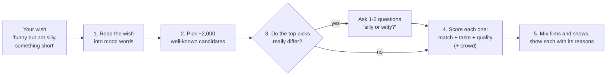

# Wishmatch: how recommendations are picked

Wishmatch is the recommender the app uses (`recommender.engine: wishmatch`). It replaced an
older rules engine ("legacy"), which is still there as a safety net: if Wishmatch ever fails,
legacy answers and the log says so.

## The idea in one picture

## 1. Reading the wish

The app has a fixed vocabulary of mood words (`services/vibe_vocab.py`): 14 **dials** (how
funny, how dark, how fast, grounded or fantastical...) and **feelings and occasions** (cosy,
tense, heartwarming, date night, background...).

Two readers turn your typed words into that vocabulary:

- **The word lookup** (instant): a list of words and phrases and what they mean, in
  `recommender_rules.yaml` under `wishmatch.lexicon`. "laugh" means funny, "not scary" rules out
  tense and horror, "80s" sets the years, "sci-fi" means Science Fiction.
- **The wish reader** (a small AI model, Qwen 2.5 3B, running in Ollama on the server):
  for words the lookup doesn't know ("something like a warm hug"). It may only answer with
  vocabulary words. It is free but slow on the server's processor (4-8 seconds for a new wish),
  so:
  - when the lookup understood every word, the search doesn't wait for the model,
  - a search waits at most `wait_seconds` (8); a slower answer is kept for "Show more",
  - every answer is saved (`wishmatch_wishes.json`), so the same wish is instant next time,
  - the model stays loaded for an hour after a search (about 2.5 GB of memory).

A word that does nothing is fixed by adding it to `wishmatch.lexicon`, not by changing code.

## 2. Candidates

Wishmatch doesn't score all 50,000 titles. It takes about 2,000 that are **well known**
(how well the tagging model knew a title is a good sign of how famous it is), split 70/30
between films and shows, plus up to 300 films that MovieLens fans of your favourites also loved
(see "crowd" below). Asking for "hidden gems" swaps in the less-known ones instead.

Hard limits come first: a typed genre ("comedy"), years ("80s"), a country or language
("korean"), and anything already seen (see "together" below).

## 3. Questions (at most two)

Wishmatch looks at its top 40 picks. If they spread widely on one dial (some silly, some
witty) or split between feelings, it asks about that, with two example titles per answer. It
never asks about something your wish already said, and asks nothing when the picks agree.
An answer counts half as much as a word you typed. The AI model words the question; if it is
slow, a plain "Which feels right: A or B?" is used.

## 4. Scoring

Each candidate gets one number, made of:

| Part | Weight | What it measures |
|---|---|---|
| match | 1.0 | how well the title's mood tags fit the wish's words |
| taste | 0.6 | how much this person (or both of you) liked titles with similar moods |
| quality | 0.3 | its rating, counting less when few people voted |
| crowd | 0.4 | films only: MovieLens fans of films you loved also loved this |
| genre hint | 0.4 | a word that hints at a genre ("scary" -> Horror) |

All weights live in `recommender_rules.yaml` under `wishmatch.weights`.

**Taste** comes from your verdicts: feelings and dials that are more common among titles you
loved than among everything you rated count for you; the same for what you disliked. Your
written **taste profile** (made at Train time, see [training](training.md)) adds what you
declared you like or avoid. With few ratings, taste counts less (it is "shrunk").

**Alone or together:**
- Alone: your own taste, plus the other person's at 0.2. Anything you've seen is left out.
- Together: both tastes count the same, and a title either of you would dislike is pushed
  down. What both have seen is left out; what one has seen drops below unseen titles.

## 5. Results

Films and shows are mixed 2:1 (`wishmatch.mix`). Each card shows up to three reasons ("cosy,
witty, fans of Paddington loved it"). Content warnings are never shown as reasons.

## Costs

Free. The wish reader runs on the server, the tagging on the Mac. The only paid option is
writing taste profiles or tags with Claude Haiku instead (under 1 cent per Train for
profiles, about 1 cent per 100 titles for tags), and only when you ask for it.

## Tuning it

| To... | Change (in `recommender_rules.yaml`) |
|---|---|
| teach it a word | `wishmatch.lexicon` (or `wishmatch.genre_hints` for a genre) |
| more shows, fewer films | `wishmatch.mix` |
| more famous / more obscure picks | `wishmatch.candidates.known`, `min_popularity` |
| care more about your taste than the wish | `wishmatch.weights.taste` up, `match` down |
| fewer or no questions | `wishmatch.questions.max` |
| wait less for the AI reader | `wishmatch.wish_reader.wait_seconds` |
| let the partner count more when alone | `wishmatch.people.other_weight` |

After a change, `uv run python utils/compare_engines.py` runs 30 sample wishes and checks each
top 10 (right genre, well known, nothing already seen...) on a copy of the catalogue.

## Where it lives

- `packages/wishmatch/`: the core. It knows nothing about films, so it can be lifted out
  for another project (music, food) by writing a new adapter.
- `services/wishmatch_movies/`: the film and TV part (reads the catalogue, the questions
  pop-up, the engine switch).
- Live status: `GET /api/rec/status` (is the wish reader up, how long it took last time).

What is planned next is in `docs/WISHMATCH_NEXT.md`.
